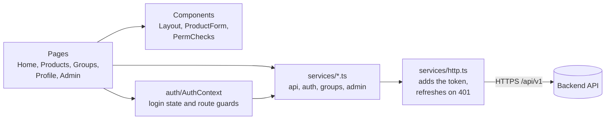
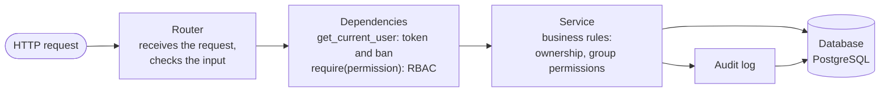
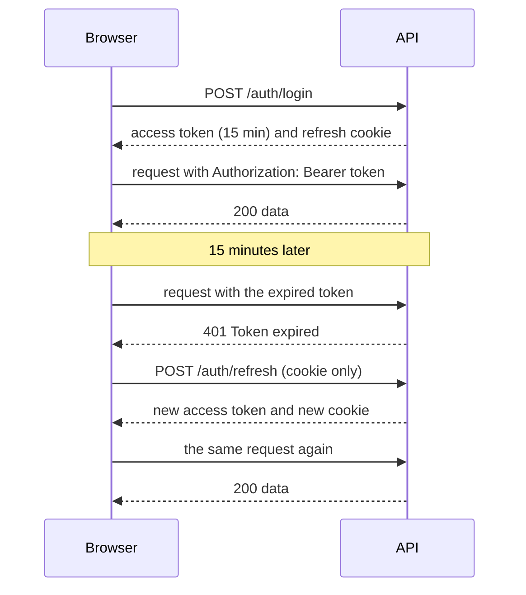

# Supply Mart

A small grocery marketplace for Bangladesh. People sign up, list everyday items (rice, lentils, oil, vegetables, fish, eggs, spices) as their own products, and form shop teams (groups) where members hold different permissions. An admin moderates users and content through a dashboard. Built with a FastAPI REST API and a React + TypeScript frontend, deployed on Vercel.

- Live app: https://2310364-s6-supply-mart.vercel.app
- API docs: https://2310364-s6-supply-mart.vercel.app/api/docs

> **Status:** final version. JWT login, roles, group permissions, the admin dashboard and the automated tests are done and live on Vercel.

## Features

**Mid project**

- Product list with search, filter, sort and pagination
- Create, view, update and delete products through a REST API (`/api/v1/products`)
- Input validation with clear error responses

**Final project**

- Sign up, log in, log out: JWT access token (15 minutes) and a rotating httpOnly refresh cookie
- Profile page: change your name, phone and password; list and revoke your sessions
- Roles `user` and `admin`, stored in the database and enforced on the server
- Ownership rules: you can only change or delete your own products
- Groups: create a group, add members, give each member `create`, `update` or `stock` permission; only the owner can rename, delete or manage members
- Admin dashboard: statistics, users (search, filters, ban and unban, role change, bulk actions), content moderation, activity log, security view, CSV export
- Security: Argon2 password hashing with a pepper, login lockout, secure cookies, security headers, CORS limited to the frontend

## Tech stack

| Part | Choice |
|---|---|
| Backend | Python 3.10+, FastAPI, SQLModel |
| Database | Supabase PostgreSQL (production), SQLite (local) |
| Frontend | React + TypeScript + Vite |
| Auth | PyJWT (access token), pwdlib with Argon2 (passwords) |
| Tests | pytest |
| Hosting | Vercel (frontend and backend in one project) |

## Documentation

| Doc | What it covers |
|---|---|
| [PRD: Product Requirements Document](docs/01-prd.md) | Mid project: goals, features, user stories |
| [SRS: Software Requirements Specification](docs/02-srs.md) | Mid project: requirements and acceptance criteria |
| [TDD: Technical Design Document](docs/03-tdd.md) | Mid project: architecture, data model, API |
| [Final report](docs/FINAL_REPORT.md) | Final project: PRD, SRS and TDD of the finished work (JWT, RBAC, admin dashboard) |

## Project structure

```
backend/    FastAPI app (routes under /api/v1)
frontend/   Vite + React + TypeScript
docs/       PRD, SRS, TDD and the final report
vercel.json Vercel setup: /api/* goes to backend, everything else to frontend
```

## How it works

### Frontend



A page shows the screen and keeps its data, components draw the pieces, `AuthContext` knows who is logged in, and `services/http.ts` is the only place that talks to the backend: it adds the access token to every request and refreshes it once when the server answers 401.

### Backend



Each layer has one job: the router handles HTTP, the dependencies check who you are and what your role may do (`app/rbac.py`), the service decides what is allowed (for example, only the owner can delete a product), and the database stores the data. Security events are written to the audit log. The response goes back up the same way.

### Login and token refresh



## Test accounts (for the instructor)

Passwords are in the submission form and the PDF report, not in this repository.

| User ID (email) | Role | Notes |
|---|---|---|
| admin1@supplymart.test | admin | |
| admin2@supplymart.test | admin | |
| rahim@supplymart.test | user | owner of the group "Mirpur Fresh Mart" |
| karim@supplymart.test | user | member of the group with `create`, `update` |
| salma@supplymart.test | user | member of the group with `stock` only |

Shared group: **Mirpur Fresh Mart**, owner rahim. Karim may add and edit products, Salma may only change stock, and neither can rename or delete the group or manage members.

## Requirements

- [Python](https://www.python.org/downloads/) 3.10+
- [Node.js](https://nodejs.org/) 22+

> On macOS/Linux, use `python3` instead of `python`.

## Run locally

You need two terminals: one for the backend and one for the frontend. Data is saved in a local SQLite file in the `backend` folder, which is created automatically on the first run and is not committed. Locally no environment variables are needed.

### First time (initial setup)

**Backend** (terminal 1):

```bash
cd backend
python -m venv .venv
.venv\Scripts\Activate.ps1      # macOS/Linux: source .venv/bin/activate
pip install -r requirements.txt
fastapi dev main.py
```

**Frontend** (terminal 2):

```bash
cd frontend
npm install
npm run dev
```

### Running again

**Backend**: activate the virtual environment, then `fastapi dev main.py`. **Frontend**: `npm run dev`. Run `pip install -r requirements.txt` or `npm install` again only when a dependency changes.

Open http://localhost:5173. Vite forwards `/api` requests to the backend on port 8000. API docs: http://localhost:8000/api/docs.

### Demo accounts and tests

Create the demo accounts (the password is read from the environment, choose your own):

```bash
cd backend
DEMO_PASSWORD="<choose-one>" python -m app.seed_demo     # PowerShell: $env:DEMO_PASSWORD="<choose-one>"; python -m app.seed_demo
```

Run the automated tests (21 tests):

```bash
cd backend
python -m pytest -q
```

> **Reset the data:** stop the backend and delete the SQLite file in `backend`.

## Environment variables

Locally nothing needs to be set. In production (Vercel) set these under **Project > Settings > Environment Variables** (a local `.env` is never committed; see `backend/.env.example`).

| Variable | Needed for | Notes |
|---|---|---|
| `DATABASE_URL` | production | Supabase transaction pooler URL (port `6543`). Leave unset locally to use SQLite. Vercel cannot keep a SQLite file between requests, so a hosted database is required. |
| `JWT_SECRET` | production | Long random string (32 or more characters), e.g. `python -c "import secrets; print(secrets.token_urlsafe(48))"` |
| `PEPPER` | production | Another random secret, mixed into the password hashes. Changing it makes existing passwords stop working. |
| `CORS_ORIGINS` | production | The frontend origin, e.g. `https://2310364-s6-supply-mart.vercel.app` |
| `ACCESS_TOKEN_MINUTES` | optional | Default `15` |
| `REFRESH_TOKEN_DAYS` | optional | Default `7` |

Never commit secrets or `.env` files.

## Deploy to Vercel

1. Push the repo to GitHub.
2. Go to https://vercel.com/new, import the repo and click **Deploy**. Keep **Root Directory** as `./`.
3. Add the environment variables above and redeploy.

Every push to `main` redeploys automatically.

## Contributing

Every change starts from a GitHub issue:

- Branch: `hridi61/#{issue_number}-{task_title}`
- Commit: `<type>: <summary> (#issue)`, e.g. `feat: add group permissions (#9)`
- One pull request per issue, with `Closes #{issue_number}` in the description

## Troubleshooting

- **"Running scripts is disabled" in PowerShell:** run `Set-ExecutionPolicy -Scope CurrentUser RemoteSigned`.
- **`fastapi` not found:** activate the virtual environment first.
- **`ModuleNotFoundError` (for example `jwt`):** run `pip install -r requirements.txt` inside the activated virtual environment, then use `python -m pytest`.
- **Demo accounts cannot log in on the live site:** the `PEPPER` used to create them must be the same as the one on Vercel.
- **`Request failed: 500` in the app:** the backend isn't running.
- **App at localhost:8000 shows an old version:** delete `frontend/dist`.
- **Vercel build fails:** check **Build Logs** in the Vercel dashboard, and make sure `npm run build` works in `frontend/`.
