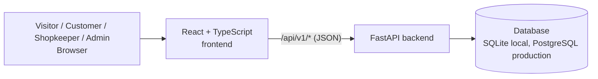
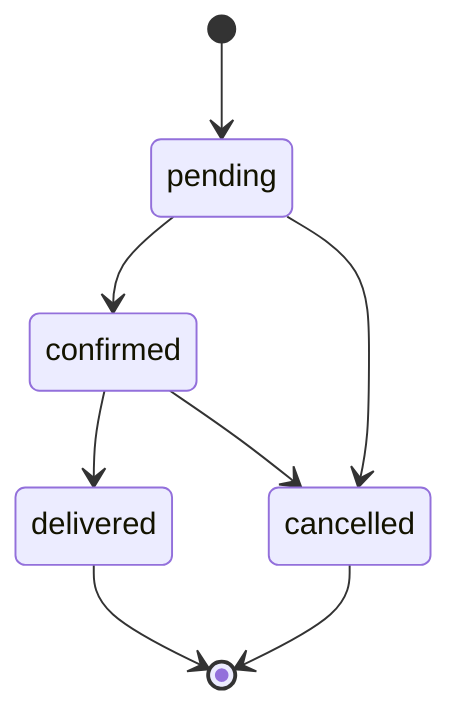

# Software Requirements Specification (SRS) — Supply Mart

| Field | Value |
|---|---|
| Product | Supply Mart |
| Version | MVP + Beta |
| Releases | MVP — Mid-term, Beta — Final |
| Status | Draft |
| Related docs | Product Requirements Document (PRD), Technical Design Document (TDD) |

Every requirement has a **Release** column: **MVP** is built for the mid-term, **Beta** is added for the final.

**Documents in this set**

| Short form | Full form | Purpose | File |
|---|---|---|---|
| PRD | Product Requirements Document | What we build and why | `01-prd.md` |
| SRS | Software Requirements Specification | Exact requirements, permissions and acceptance criteria (this document) | `02-srs.md` |
| TDD | Technical Design Document | How we build it: architecture, data model, API | `03-tdd.md` |

## 1. Introduction

### 1.1 Purpose

This document lists the requirements for Supply Mart: the MVP (product and order REST API with React pages) and the Beta (accounts, roles, security scopes, shops and dashboards), deployed on Vercel.

### 1.2 Scope

- **MVP:** a client can browse products, manage products, place orders and update order item status over HTTP. There are no accounts.
- **Beta:** users sign up and log in; customers see only their own orders; shopkeepers manage only their own products and order items; admins approve shops and see everything. Every protected endpoint checks the caller's role and security scope.
- Out of scope: see PRD, section 5.

### 1.3 Definitions

| Term | Meaning |
|---|---|
| CRUD | Create, Read, Update, Delete |
| REST | API style where resources (like products) are used with HTTP methods (GET, POST, PATCH, DELETE) |
| Product | An item for sale, with a name, category, unit, price and stock |
| Order | A purchase made by a customer, containing one or more order items |
| Order item | One product line of an order; it has its own status because a shop handles only its own lines |
| COD | Cash on Delivery, the only payment method |
| RBAC | Role-Based Access Control: what a caller can do depends on their role |
| Scope | A named permission (for example `orders:create`) carried in the access token and checked by each endpoint |
| JWT | JSON Web Token: a signed token that proves who the caller is |
| Access token | (Beta) Short-lived JWT sent in the `Authorization: Bearer` header |
| Refresh token | (Beta) Long-lived random token in an HttpOnly cookie, used to get a new access token |
| Client | Anything that calls the API: the React frontend, `/api/docs`, curl, Postman |
| OpenAPI | Standard API description; FastAPI generates it and shows it at `/api/docs` |

## 2. Overall description

### 2.1 System context

### 2.2 Users and roles

| Role | Release | Description |
|---|---|---|
| Anonymous client | MVP | Anyone who can reach the API; full access to products and orders (demo mode) |
| Visitor | Beta | Not logged in; can browse and search products, sign up, log in, check health, read the API docs |
| Customer | Beta | Logged in; places orders, sees own orders, manages own profile |
| Shopkeeper | Beta | Logged in; owns a shop (needs admin approval); manages own products and the order items of own products |
| Admin | Beta | Approves shops, lists users, sees all orders, updates any order item, sees platform statistics |

`customer`, `shopkeeper` and `admin` are global roles stored on the user. Each user has exactly one role.

### 2.3 Use cases

| ID | Use case | Actor | Release |
|---|---|---|---|
| UC-01 | Browse, search and sort products | Visitor | MVP |
| UC-02 | Manage cart and place an order | Customer | MVP |
| UC-03 | Create, update and delete products | Shopkeeper | MVP |
| UC-04 | Update order item status | Shopkeeper, Admin | MVP |
| UC-05 | Sign up and log in | Visitor | Beta |
| UC-06 | View own orders | Customer | Beta |
| UC-07 | Register a shop and wait for approval | Shopkeeper | Beta |
| UC-08 | Approve or reject a shop | Admin | Beta |
| UC-09 | View orders for own items | Shopkeeper | Beta |
| UC-10 | View users and all orders | Admin | Beta |
| UC-11 | View dashboard and edit profile | All logged-in roles | Beta |

Every Shopkeeper and Admin can also use the pages a Visitor can use.

### 2.4 Constraints

- C-1: Runs on Vercel serverless functions (no local disk that survives between requests).
- C-2: Backend in Python 3.10+ with FastAPI; frontend in React with TypeScript.
- C-3: All API routes start with `/api`, because `vercel.json` sends `/api/*` to the backend.
- C-4: Requests and responses use JSON.
- C-5: Production database is Supabase PostgreSQL; local development uses SQLite.
- C-6: (Beta) Login is implemented in our own API (no third-party login providers).

### 2.5 Assumptions

- A-1: A hosted database is available to the Vercel project through an environment variable.
- A-2: The app is used for demos and class work, so traffic is low.
- A-3: (Beta) The first admin is created by a seed script.
- A-4: MVP demo data may be removed when orders get an owner in the Beta.
- A-5: Categories are fixed and seeded.

## 3. Functional requirements

### 3.1 Catalogue — MVP

| ID | Requirement | Release | Story |
|---|---|---|---|
| FR-01 | The system shall list all categories. | MVP | US-01 |
| FR-02 | The system shall list products, newest first, with optional filters: `category` (slug), search text `q` (matches the name), and `sort` by price (`price_asc` or `price_desc`). The list shall support `offset` (default 0) and `limit` (default 20, max 100). | MVP | US-01, US-02 |
| FR-03 | The system shall return one product by its ID. | MVP | US-03 |
| FR-04 | The system shall create a product from a JSON body with `name_bn`, `category_id`, `unit`, `price`, `stock` (required) and `icon` (optional). | MVP | US-04 |
| FR-05 | The system shall update any of `name_bn`, `category_id`, `unit`, `price`, `stock`, `icon`, `is_active` on an existing product. Fields not sent stay unchanged. | MVP | US-05 |
| FR-06 | The system shall delete a product by its ID. | MVP | US-06 |

### 3.2 Orders — MVP

| ID | Requirement | Release | Story |
|---|---|---|---|
| FR-07 | The system shall create an order from `customer_name`, `phone`, `address`, optional `note` and a list of `items` (`product_id`, `quantity`). The price of every item shall be read from the database, never from the client. The system shall calculate `subtotal`, `delivery_fee` and `total`. Every new item has status `pending`. | MVP | US-07 |
| FR-08 | If any `product_id` does not exist (or is inactive), the system shall return 400 and store nothing. | MVP | US-07 |
| FR-09 | The system shall list orders, newest first, with `offset` / `limit`, and return one order by ID together with its items. | MVP | US-08 |
| FR-10 | The system shall change the status of one order item. Allowed changes: `pending` → `confirmed` or `cancelled`; `confirmed` → `delivered` or `cancelled`. Any other change returns 400. | MVP | US-08 |

**Business rules for FR-07:** delivery fee is ৳30 and is free when the subtotal is ৳500 or more. An order has 1–50 items; quantity per item is 1–50. Order items keep a copy of the product name, unit and price at the time of purchase.

### 3.3 General — MVP

| ID | Requirement | Release | Story |
|---|---|---|---|
| FR-11 | The system shall set `created_at` when a record is created and update `updated_at` on every change (products). | MVP | US-05 |
| FR-12 | The system shall reject invalid input with status 422 and a message saying which field is wrong. | MVP | US-09 |
| FR-13 | The system shall return 404 when a resource ID does not exist. | MVP | US-09 |
| FR-14 | The system shall expose `GET /api/health` returning `{"status": "ok"}`. | MVP | US-10 |
| FR-15 | The system shall publish interactive API docs at `/api/docs`. | MVP | US-10 |

### 3.4 Authentication and profile — Beta

| ID | Requirement | Release | Story |
|---|---|---|---|
| FR-16 | The system shall let a visitor sign up as a **customer** with email, name and password. Email is unique (case-insensitive); a duplicate returns 409. | Beta | US-11 |
| FR-17 | The system shall let a visitor sign up as a **shopkeeper** with email, name, password and shop name, phone and address. The shop starts with status `pending`. | Beta | US-12 |
| FR-18 | The system shall log a user in with email and password, returning an access token in the body and setting a refresh token cookie. Wrong email or password returns 401 with the same message for both. | Beta | US-13 |
| FR-19 | The system shall issue a new access token when called with a valid refresh token cookie, and replace (rotate) the refresh token. | Beta | US-13 |
| FR-20 | The system shall log a user out by revoking the refresh token and clearing the cookie. | Beta | US-13 |
| FR-21 | The system shall return the logged-in user's profile (id, email, name, phone, role, and shop for a shopkeeper). The password hash is never returned. | Beta | US-21 |
| FR-22 | A user shall be able to change their own name and phone. Email and role cannot be changed through the profile. | Beta | US-21 |
| FR-23 | A user shall be able to change their password by sending the current and the new password. A wrong current password returns 400. On success all the user's refresh tokens are revoked. | Beta | US-21, US-23 |
| FR-24 | In the Beta, every endpoint except products/categories reading, sign up, login, refresh, health and docs shall require a valid access token; otherwise it returns 401. | Beta | US-19 |

### 3.5 RBAC and security scopes — Beta

| ID | Requirement | Release | Story |
|---|---|---|---|
| FR-25 | Every user shall have exactly one global role: `customer`, `shopkeeper` or `admin`. | Beta | US-19 |
| FR-26 | The access token shall carry the scopes of the user's role (see section 3.12). Each protected endpoint shall require a specific scope; a valid token without that scope returns 403. | Beta | US-19 |
| FR-27 | On every protected request the system shall load the user and the role from the database, so a role or account change applies immediately. | Beta | US-19 |
| FR-28 | Admin accounts shall be created only by a seed script, never through public sign-up. | Beta | US-19 |

### 3.6 Shops and products — Beta

| ID | Requirement | Release | Story |
|---|---|---|---|
| FR-29 | A shopkeeper shall create, update and delete only products that belong to their own shop. Another shop's product returns 404. | Beta | US-15 |
| FR-30 | The public product list and product detail shall show only products that are active, in stock (`stock > 0`) and belong to an `approved` shop. | Beta | US-17, US-20 |
| FR-31 | An admin shall list all shops and approve or reject a shop. | Beta | US-17 |

### 3.7 Orders per role — Beta

| ID | Requirement | Release | Story |
|---|---|---|---|
| FR-32 | Creating an order shall require a logged-in customer (scope `orders:create`). The order stores the user's ID. | Beta | US-14 |
| FR-33 | When an order is created, the system shall reduce the stock of each product in one transaction. If any product has too little stock, the whole order is rejected with 400 and no stock changes. | Beta | US-20 |
| FR-34 | A customer shall list only their own orders. Opening another customer's order returns 404. | Beta | US-14 |
| FR-35 | A shopkeeper shall list only the orders that contain their own items, and see only their own items inside each order. | Beta | US-16 |
| FR-36 | A shopkeeper shall change the status of only their own order items; an admin may change any. Anyone else gets 403. | Beta | US-16, US-08 |
| FR-37 | An admin shall list all orders and all users. | Beta | US-18 |

### 3.8 Dashboard — Beta

| ID | Requirement | Release | Story |
|---|---|---|---|
| FR-38 | The dashboard shall return role-specific numbers: customer (order count, total spent), shopkeeper (product count, number of orders with own items, revenue from delivered own items, shop status), admin (users by role, shops by status, order count). | Beta | US-22 |

### 3.9 Account security — Beta

| ID | Requirement | Release | Story |
|---|---|---|---|
| FR-39 | After 5 failed logins in a row for an email, the system shall block logins for that account for 15 minutes and return 429. A successful login resets the counter. | Beta | US-23 |

### 3.10 Validation rules

| Field | Rule | Release |
|---|---|---|
| `name_bn` (product) | Required on create, string, 2–60 characters after trimming | MVP |
| `unit` | One of `kg`, `litre`, `dozen`, `piece` | MVP |
| `price` | Integer taka, 1–100000 | MVP |
| `stock` | Integer, 0–10000 | MVP |
| `icon` | Optional, max 8 characters | MVP |
| `q` (search) | Optional, max 100 characters | MVP |
| `offset` | Integer ≥ 0 | MVP |
| `limit` | Integer 1–100 | MVP |
| `customer_name` | 2–100 characters | MVP |
| `phone` | Bangladesh mobile number: `01[3-9]` followed by 8 digits | MVP |
| `address` | 10–300 characters | MVP |
| `note` | Optional, max 300 characters | MVP |
| `items` | 1–50 lines; `quantity` integer 1–50 | MVP |
| `email` | Valid email, max 254 characters, stored lowercase | Beta |
| `name` (user) | 2–100 characters | Beta |
| `password` | 8–128 characters | Beta |
| `shop_name` | 2–60 characters | Beta |
| `status` (order item) | `pending`, `confirmed`, `delivered` or `cancelled` | MVP |
| `status` (shop approval) | `approved` or `rejected` | Beta |

### 3.11 Order item states

A new order item always starts as `pending`. `delivered` and `cancelled` are final. The overall status of an order is calculated from its items (all delivered → delivered; all cancelled → cancelled; any item past pending → processing; otherwise pending).

### 3.12 Permission matrix and scopes — Beta

**Permission matrix**

| Action | Visitor | Customer | Shopkeeper | Admin |
|---|:---:|:---:|:---:|:---:|
| Browse / search products and categories | Yes | Yes | Yes | Yes |
| Sign up, log in | Yes | — | — | — |
| Log out, view and edit own profile, dashboard | No (401) | Yes | Yes | Yes |
| Place an order | No (401) | Yes | No (403) | No (403) |
| View own orders | No (401) | Yes | No (403) | No (403) |
| Open another customer's order | No (401) | No (404) | No (404) | Yes |
| Create / update / delete own products | No (401) | No (403) | Yes | No (403) |
| Touch another shop's product | No (401) | No (403) | No (404) | No (403) |
| View orders containing own items | No (401) | No (403) | Yes | No (403) |
| Change status of own order items | No (401) | No (403) | Yes | Yes (any) |
| List shops, approve or reject a shop | No (401) | No (403) | No (403) | Yes |
| List all users, list all orders | No (401) | No (403) | No (403) | Yes |

**Scopes**

| Scope | Meaning | Granted to |
|---|---|---|
| `profile:read` | Read own profile and dashboard | Customer, Shopkeeper, Admin |
| `profile:write` | Change own name, phone, password | Customer, Shopkeeper, Admin |
| `orders:create` | Place an order | Customer |
| `orders:read_own` | List own orders | Customer |
| `products:write` | Create, update, delete own products | Shopkeeper |
| `orders:read_shop` | List orders that contain own items | Shopkeeper |
| `orders:update_shop` | Change status of own order items | Shopkeeper |
| `shops:read` | List all shops | Admin |
| `shops:approve` | Approve or reject shops | Admin |
| `users:read` | List all users | Admin |
| `orders:read_all` | List all orders and open any order | Admin |
| `orders:update_any` | Change status of any order item | Admin |

A scope says *what kind* of action is allowed. Ownership rules (own product, own order, own items) decide *on which data*, as in the matrix above.

### 3.13 Status codes

| Case | Code | Release |
|---|---|---|
| Resource created | `201 Created` | MVP |
| Read or update succeeded | `200 OK` | MVP |
| Deleted / logged out / password changed | `204 No Content` | MVP |
| Bad request (unknown product, invalid status change, not enough stock, wrong current password) | `400 Bad Request` | MVP |
| Validation failed | `422 Unprocessable Content` | MVP |
| Resource not found, or caller may not know it exists | `404 Not Found` | MVP |
| Unexpected server error | `500 Internal Server Error` | MVP |
| Missing, invalid or expired token; wrong login | `401 Unauthorized` | Beta |
| Logged in but role or scope not allowed | `403 Forbidden` | Beta |
| Duplicate (email taken) | `409 Conflict` | Beta |
| Too many failed logins | `429 Too Many Requests` | Beta |

## 4. Non-functional requirements

| ID | Category | Requirement | Release |
|---|---|---|---|
| NFR-01 | Performance | 95% of list and detail requests answer in under 500 ms for up to 1,000 products (excluding a cold start). | MVP |
| NFR-02 | Persistence | Data is stored in a database and is not lost on restart or redeploy. | MVP |
| NFR-03 | Reliability | Creating an order (stock update and inserts) is atomic: a failure leaves no partial data. | MVP |
| NFR-04 | Security | Database queries use the ORM with parameters, never string-built SQL. | MVP |
| NFR-05 | Security | Error responses do not expose stack traces or database details. | MVP |
| NFR-06 | Security | Database credentials and secrets are stored only in environment variables, never in Git. | MVP |
| NFR-07 | Maintainability | Code is split into layers: routes, schemas, models, services, database. | MVP |
| NFR-08 | Usability (API) | Every endpoint is listed in `/api/docs` with request and response schemas. | MVP |
| NFR-09 | Usability (UI) | The interface works on mobile, tablet and desktop widths (from 360 px). | MVP |
| NFR-10 | Compatibility | The app works on the latest Chrome, Edge and Firefox. | MVP |
| NFR-11 | Deployability | The app runs on Vercel; a push to `main` updates production. | Beta |
| NFR-12 | Security | All traffic uses HTTPS (provided by Vercel). | Beta |
| NFR-13 | Security | Passwords are hashed with Argon2; plain passwords are never stored, logged or returned. | Beta |
| NFR-14 | Security | Access tokens are JWTs signed with a secret of at least 32 bytes from an environment variable, valid for 15 minutes. | Beta |
| NFR-15 | Security | Refresh tokens are random, valid for 7 days, stored only as a hash, and replaced on every refresh. | Beta |
| NFR-16 | Security | The refresh token cookie is HttpOnly, Secure, SameSite=Strict and limited to the path `/api/v1/auth`. | Beta |
| NFR-17 | Security | Frontend and API share one origin, so CORS stays disabled. | Beta |
| NFR-18 | Security | Responses include security headers: `X-Content-Type-Options`, `X-Frame-Options`, `Referrer-Policy`, `Strict-Transport-Security`. | Beta |
| NFR-19 | Security | Every permission check runs on the server for every request; hiding a button in the frontend is never the only protection. | Beta |
| NFR-20 | Performance | Sign up and login answer in under 1 s (password hashing is slow on purpose). | Beta |
| NFR-21 | Maintainability | Database schema changes are made through Alembic migrations, not by hand. | Beta |
| NFR-22 | Testability | Automated tests cover `401`, `403` and success for each role on the main endpoints. | Beta |

## 5. Acceptance criteria

### MVP

**AC-01 List products (FR-02)**
- Given products exist in several categories
- When the client sends `GET /api/v1/products?category=dal&sort=price_asc`
- Then the response is `200` with only products of that category, cheapest first.

**AC-02 Create product (FR-04, FR-11)**
- Given a valid body (`name_bn`, `category_id`, `unit`, `price`, `stock`)
- When the client sends `POST /api/v1/products`
- Then the response is `201` with an `id`, `is_active: true` and `created_at` set.

**AC-03 Create product with a wrong price (FR-12)**
- Given a body with `price: 0`
- When the client sends `POST /api/v1/products`
- Then the response is `422` and mentions `price`.

**AC-04 Get missing product (FR-13)**
- When the client sends `GET /api/v1/products/9999` and no such product exists
- Then the response is `404`.

**AC-05 Update product (FR-05)**
- Given product 5 exists with `price: 72`
- When the client sends `PATCH /api/v1/products/5` with `{"price": 75}`
- Then the response is `200`, `price` is 75 and the other fields are unchanged.

**AC-06 Place order (FR-07)**
- Given product 4 costs ৳72 and product 9 costs ৳150
- When the client sends `POST /api/v1/orders` with 2 × product 4 and 1 × product 9, and a price of 1 sent by the client
- Then the response is `201`, the stored price is ৳72 (not 1), `subtotal` is 294, `delivery_fee` is 30, `total` is 324 and every item is `pending`.

**AC-07 Free delivery (FR-07)**
- Given the subtotal is ৳500 or more
- When the order is created
- Then `delivery_fee` is 0.

**AC-08 Unknown product in order (FR-08)**
- Given an order that contains `product_id: 9999`
- When the client sends `POST /api/v1/orders`
- Then the response is `400` and no order is stored.

**AC-09 Change item status (FR-10)**
- Given an order item with status `pending`
- When the client sends `PATCH /api/v1/order-items/{id}/status` with `{"status": "confirmed"}`
- Then the response is `200` and the status is `confirmed`.
- When the client then sends `{"status": "pending"}`, the response is `400`.

**AC-10 Health (FR-14)**
- When the client sends `GET /api/health`
- Then the response is `200` with `{"status": "ok"}`.

### Beta

**AC-11 Sign up (FR-16)**
- Given no account exists for `a@x.com`
- When a visitor signs up with that email
- Then the response is `201` with role `customer` and no password field.
- When anyone signs up again with `A@x.com`, the response is `409`.

**AC-12 Shopkeeper sign up (FR-17)**
- When a visitor signs up as a shopkeeper with shop details
- Then the response is `201`, the role is `shopkeeper` and the shop status is `pending`.

**AC-13 Log in (FR-18)**
- Given user `a@x.com` exists
- When they log in with the right password
- Then the response is `200` with an `access_token`, and a `refresh_token` cookie is set.
- When they log in with a wrong password, the response is `401`.

**AC-14 Token required (FR-24)**
- When a client calls `POST /api/v1/orders` without a token, or with an expired one
- Then the response is `401`.

**AC-15 Scope required (FR-26)**
- Given a logged-in shopkeeper
- When they call `POST /api/v1/orders`
- Then the response is `403`.
- Given a logged-in customer, when they call `GET /api/v1/admin/users`, the response is `403`.

**AC-16 Own products only (FR-29)**
- Given shopkeeper A owns product 5 and shopkeeper B does not
- When B sends `PATCH /api/v1/shop/products/5`
- Then the response is `404` and the product is unchanged.

**AC-17 Approval controls visibility (FR-30, FR-31)**
- Given a new shop is `pending` and has a product
- When a visitor lists products, the product is not in the list.
- When an admin approves the shop, the product appears in the list.

**AC-18 Stock (FR-33)**
- Given product 4 has `stock: 3`
- When a customer orders 5 of it
- Then the response is `400`, no order is stored and the stock is still 3.
- When the customer orders 2, the response is `201` and the stock becomes 1.

**AC-19 Private orders (FR-34, FR-35)**
- Given customer A has order 7
- When customer B sends `GET /api/v1/orders/7`
- Then the response is `404`.
- When shopkeeper S lists `GET /api/v1/shop/orders`, only orders that contain S's items appear, with only S's items inside.

**AC-20 Item status by owner only (FR-36)**
- Given an order item that belongs to shop S1
- When shopkeeper S2 changes its status, the response is `403`.
- When S1 or an admin changes it, the response is `200`.

**AC-21 Admin lists (FR-31, FR-37)**
- When an admin calls `GET /api/v1/admin/users`, `GET /api/v1/admin/shops` and `GET /api/v1/admin/orders`
- Then each response is `200`; for any other role the response is `403`.

**AC-22 Dashboard (FR-38)**
- Given a customer with 3 orders
- When they call `GET /api/v1/dashboard`
- Then the response contains their order count and total spent; an admin gets platform totals instead.

**AC-23 Login lockout (FR-39)**
- Given 5 failed logins in a row for `a@x.com`
- When the right password is sent within 15 minutes
- Then the response is `429`; after 15 minutes the login succeeds.

**AC-24 Change password (FR-23)**
- When a user sends a wrong `current_password`, the response is `400`.
- When they send the right one and a valid `new_password`, the response is `204`, their refresh token no longer works and they can log in only with the new password.

## 6. Traceability

| Story | Requirements | Endpoint (see TDD, section 6) | Release |
|---|---|---|---|
| US-01 | FR-01, FR-02 | `GET /api/v1/categories`, `GET /api/v1/products` | MVP |
| US-02 | FR-02 | `GET /api/v1/products?q=&sort=` | MVP |
| US-03 | FR-03 | `GET /api/v1/products/{id}` | MVP |
| US-04 | FR-04 | `POST /api/v1/products` | MVP |
| US-05 | FR-05, FR-11 | `PATCH /api/v1/products/{id}` | MVP |
| US-06 | FR-06 | `DELETE /api/v1/products/{id}` | MVP |
| US-07 | FR-07, FR-08 | `POST /api/v1/orders` | MVP |
| US-08 | FR-09, FR-10, FR-36 | `GET /api/v1/orders`, `PATCH /api/v1/order-items/{id}/status` | MVP |
| US-09 | FR-12, FR-13 | All endpoints | MVP |
| US-10 | FR-14, FR-15 | `GET /api/health`, `/api/docs` | MVP |
| US-11 | FR-16 | `POST /api/v1/auth/signup` | Beta |
| US-12 | FR-17 | `POST /api/v1/auth/signup-shop` | Beta |
| US-13 | FR-18 – FR-20 | `/api/v1/auth/login`, `/refresh`, `/logout` | Beta |
| US-14 | FR-32, FR-34 | `POST /api/v1/orders`, `GET /api/v1/orders/me` | Beta |
| US-15 | FR-29 | `/api/v1/shop/products` | Beta |
| US-16 | FR-35, FR-36 | `GET /api/v1/shop/orders`, `PATCH /api/v1/order-items/{id}/status` | Beta |
| US-17 | FR-30, FR-31 | `GET /api/v1/admin/shops`, `PATCH /api/v1/admin/shops/{id}/approval` | Beta |
| US-18 | FR-37 | `GET /api/v1/admin/users`, `GET /api/v1/admin/orders` | Beta |
| US-19 | FR-24 – FR-28 | All protected endpoints | Beta |
| US-20 | FR-30, FR-33 | `POST /api/v1/orders` | Beta |
| US-21 | FR-21 – FR-23 | `GET`, `PATCH /api/v1/users/me`, `POST /api/v1/users/me/password` | Beta |
| US-22 | FR-38 | `GET /api/v1/dashboard` | Beta |
| US-23 | FR-23, FR-39, NFR-13 – NFR-16 | `POST /api/v1/auth/login` | Beta |
| <!-- SRS documentation update -->
