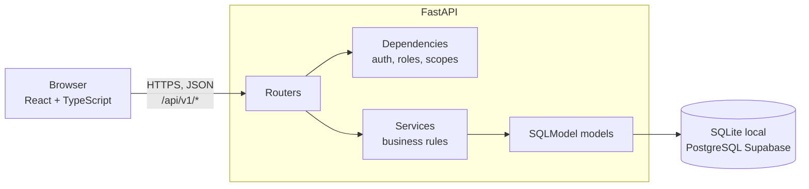
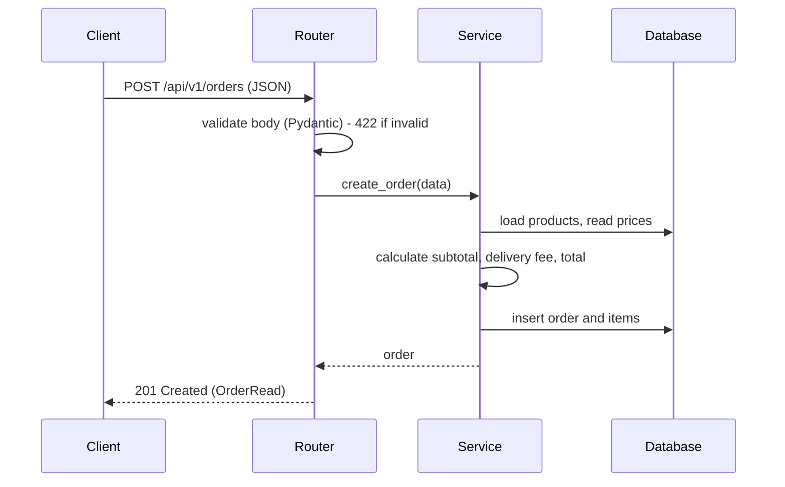
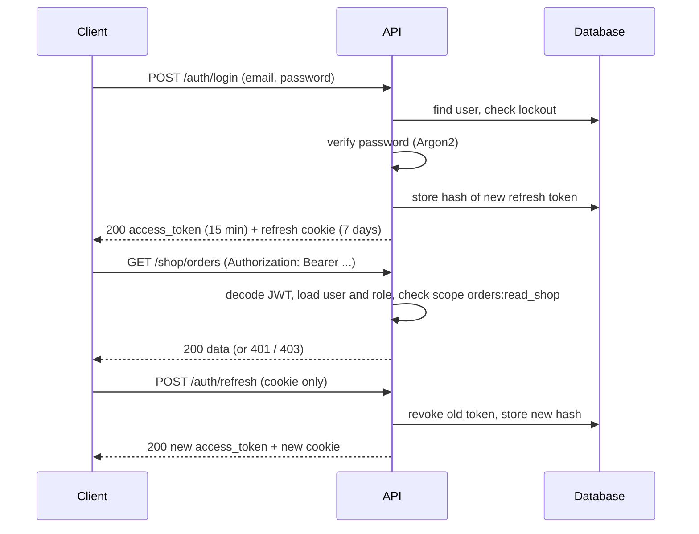
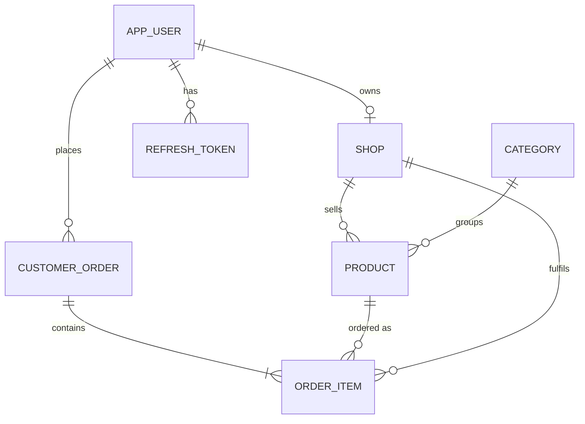

# Technical Design Document (TDD) — Supply Mart

| Field | Value |
|---|---|
| Product | Supply Mart |
| Version | MVP + Beta |
| Releases | MVP — Mid-term, Beta — Final |
| Status | Draft |
| Related docs | Product Requirements Document (PRD), Software Requirements Specification (SRS) |

Sections and tables are marked **MVP** or **Beta**. Build the MVP parts for the mid-term; the Beta parts extend them for the final.

**Documents in this set**

| Short form | Full form | Purpose | File |
|---|---|---|---|
| PRD | Product Requirements Document | What we build and why | `01-prd.md` |
| SRS | Software Requirements Specification | Exact requirements, permissions and acceptance criteria | `02-srs.md` |
| TDD | Technical Design Document | How we build it: architecture, data model, API (this document) | `03-tdd.md` |

## 1. Overview

- **MVP:** a FastAPI REST API for categories, products and orders, stored in a SQL database through SQLModel, with React + TypeScript pages (browse, cart, checkout, orders). Runs locally.
- **Beta:** the same app gains users and login (JWT), three global roles (customer, shopkeeper, admin), security scopes on every protected endpoint, shops with admin approval, stock tracking, dashboards and security hardening. Schema changes are managed with Alembic. The app is deployed to Vercel as one project.

## 2. Tech stack

| Layer | Choice | Why | Release |
|---|---|---|---|
| API | FastAPI | Validation, OpenAPI docs, security scopes and type hints out of the box; in the course template | MVP |
| ORM / models | SQLModel | One class works as both the Pydantic schema and the database table | MVP |
| Database (local) | SQLite | No setup needed | MVP |
| Frontend | Vite + React + TypeScript (strict) | In the course template | MVP |
| Routing | React Router | Pages and protected routes | MVP |
| Styling | Tailwind CSS | Quick responsive layout | MVP |
| Database (production) | PostgreSQL on Supabase | Free tier, managed Postgres, connection pooler for serverless | Beta |
| DB driver | `psycopg[binary]` (psycopg 3) | Standard Postgres driver for SQLAlchemy / SQLModel | Beta |
| Hosting | Vercel | Frontend and backend in one project (`vercel.json`), auto deploy from GitHub | Beta |
| Migrations | Alembic | Versioned schema changes as the model grows from 4 to 7 tables | Beta |
| JWT | PyJWT | Sign and verify access tokens | Beta |
| Password hashing | `pwdlib[argon2]` | Argon2 hashing | Beta |
| Tests | `pytest` + FastAPI `TestClient` | 401 / 403 / success tests | Beta |

## 3. Architecture



`vercel.json` already routes `/api/*` to the backend service and everything else to the frontend, so every backend route must start with `/api`. For the same reason the API docs are served at `/api/docs` (not FastAPI's default `/docs`):

```python
app = FastAPI(title="Supply Mart API", docs_url="/api/docs",
              openapi_url="/api/openapi.json", redoc_url=None)
```

### 3.1 Request flow — MVP



### 3.2 Login and refresh flow — Beta



## 4. Project structure

```
backend/
  main.py              # creates the app, includes each feature's router, health check, catch-all 500 handler
  app/
    config.py          # settings from env vars
    database.py        # engine, get_session(), SessionDep, create_db_and_tables() (MVP)
    security.py        # (Beta) password hashing, JWT create/verify, refresh tokens, SCOPES_BY_ROLE
    seed.py            # categories, demo products; (Beta) admin user
    catalog/           # one folder per feature (domain)
      router.py        # /api/v1/categories, /api/v1/products
      schemas.py       # ProductCreate / ProductUpdate / ProductRead, CategoryRead
      models.py        # Category, Product tables
      service.py       # business rules and queries (no HTTP)
      dependencies.py  # valid_product: resolves {product_id} to a Product or answers 404
    orders/
      router.py        # /api/v1/orders, /api/v1/order-items/{id}/status
      schemas.py       # OrderCreate / OrderRead / ItemStatusUpdate
      models.py        # CustomerOrder, OrderItem tables
      service.py       # create_order, status transitions
    auth/              # (Beta) router, schemas, models (AppUser, RefreshToken), service, dependencies (get_current_user)
    users/             # (Beta) /api/v1/users/me (profile, change password)
    shops/             # (Beta) Shop model, /api/v1/shop/* for shopkeepers
    admin/             # (Beta) /api/v1/admin/*
    dashboard/         # (Beta) /api/v1/dashboard
  alembic/             # (Beta) migration scripts
  alembic.ini          # (Beta)
  tests/               # (Beta) pytest
  requirements.txt
frontend/
  src/
    api/               # client.ts (fetch wrapper), one file per resource
    auth/              # (Beta) AuthContext, ProtectedRoute
    cart/              # CartContext (cart kept in the browser)
    components/        # ProductCard, QtyStepper, Navbar ...
    pages/             # Home, Category, ProductDetails, Cart, Checkout, Orders (Beta: Login, Signup, ShopPanel, AdminPanel, Profile)
    types/             # shared TypeScript types for API data
docs/
  01-prd.md
  02-srs.md
  03-tdd.md
```

The backend is organised by feature (domain): each folder holds its own router, schemas, models and service. A router parses the request and calls the service; dependencies (`Depends`) do the reusable checks such as loading a product, answering 404 and, in the Beta, the role and scope checks; the service holds the business rules and queries and knows nothing about HTTP. `main.py` only wires the routers together.

## 5. Data model

### 5.1 MVP tables

Money is stored as whole taka (`int`), so there are no floating-point errors. `order` is a reserved word in SQL, so the table is named `customer_order`.

**category**

| Column | Type | Rules |
|---|---|---|
| id | integer | Primary key |
| slug | varchar(40) | Unique (for example `dal`, `mach`) |
| name_bn | varchar(60) | Not null |
| icon | varchar(8) | Not null (emoji) |

**product**

| Column | Type | Rules |
|---|---|---|
| id | integer | Primary key |
| category_id | integer | FK → category.id, not null |
| name_bn | varchar(60) | Not null |
| unit | varchar(10) | `kg`, `litre`, `dozen` or `piece` |
| price | integer | Not null, 1–100000 |
| stock | integer | Not null, default 0 |
| icon | varchar(8) | Nullable (falls back to the category icon) |
| is_active | boolean | Not null, default true |
| created_at, updated_at | timestamp (UTC) | Not null |

**customer_order**

| Column | Type | Rules |
|---|---|---|
| id | integer | Primary key |
| customer_name | varchar(100) | Not null |
| phone | varchar(11) | Not null |
| address | varchar(300) | Not null |
| note | varchar(300) | Nullable |
| subtotal, delivery_fee, total | integer | Not null |
| payment | varchar(10) | Always `cod` |
| created_at | timestamp (UTC) | Not null |

**order_item**

| Column | Type | Rules |
|---|---|---|
| id | integer | Primary key |
| order_id | integer | FK → customer_order.id, on delete cascade |
| product_id | integer | FK → product.id, on delete set null (the copy below keeps the history) |
| name_bn, unit, price | — | Copied from the product at purchase time |
| quantity | integer | 1–50 |
| status | varchar(10) | `pending`, `confirmed`, `delivered`, `cancelled`; default `pending` |

### 5.2 Beta additions

| Table / column | Details |
|---|---|
| **app_user** (new) | `id`, `email` (unique, lowercase), `name`, `phone`, `password_hash` (Argon2, never returned), `role` (`customer` / `shopkeeper` / `admin`), `failed_login_count` (default 0), `locked_until` (nullable), `created_at`, `updated_at` |
| **refresh_token** (new) | `id`, `user_id` (FK → app_user, on delete cascade), `token_hash` (SHA-256, unique), `expires_at`, `revoked_at` (nullable), `created_at` |
| **shop** (new) | `id`, `owner_id` (FK → app_user, unique), `name`, `phone`, `address`, `status` (`pending` / `approved` / `rejected`, default `pending`), `created_at` |
| `product.shop_id` (new) | FK → shop.id, nullable. `null` = platform demo product |
| `customer_order.user_id` (new) | FK → app_user.id, nullable (null only for MVP demo orders) |
| `order_item.shop_id` (new) | FK → shop.id, nullable. Copied from the product so the shop can see its own lines |

Indexes: `product(category_id)`, `product(shop_id)`, `order_item(order_id)`, `order_item(shop_id)`, `customer_order(user_id)`, `refresh_token(user_id)`.



Who can see what:
- **Product:** public only if `is_active`, `stock > 0` and its shop is `approved` (or it is a platform product).
- **Order:** its customer and admins. A shopkeeper sees only the items whose `shop_id` is their shop.

### 5.3 Schemas

| Schema | Used for | Fields | Release |
|---|---|---|---|
| `ProductCreate` | POST product body | `name_bn`, `category_id`, `unit`, `price`, `stock`, `icon?` | MVP |
| `ProductUpdate` | PATCH product body | all optional, plus `is_active` | MVP |
| `ProductRead` | Product responses | all columns, `category` slug and Bengali name, `shop_name?` | MVP |
| `OrderCreate` | POST order body | `customer_name`, `phone`, `address`, `note?`, `items: [{product_id, quantity}]` | MVP |
| `OrderRead` | Order responses | order columns + `items` (+ `status` calculated) | MVP |
| `ItemStatusUpdate` | PATCH item status | `status` | MVP |
| `SignupRequest` | Sign up | `email`, `name`, `password` (+ `phone`) | Beta |
| `ShopSignupRequest` | Shopkeeper sign up | `SignupRequest` + `shop_name`, `shop_phone`, `shop_address` | Beta |
| `TokenResponse` | Login / refresh | `access_token`, `token_type: "bearer"`, `expires_in` | Beta |
| `UserRead` | User responses | `id`, `email`, `name`, `phone`, `role`, `shop?` (never `password_hash`) | Beta |
| `ProfileUpdate` | Change own details | `name?`, `phone?` | Beta |
| `PasswordChange` | Change own password | `current_password`, `new_password` | Beta |
| `ShopApproval` | Approve or reject | `status` | Beta |
| `DashboardRead` | Dashboard | role-specific numbers | Beta |

## 6. REST API design

Base path: `/api/v1`. All bodies are JSON (login uses the standard OAuth2 form: `username` = email, `password`, so Swagger's **Authorize** button works).

### 6.1 Endpoints — MVP

In the MVP no login is needed. In the Beta the write endpoints below are replaced or protected (see 6.2).

| Method | Path | Body | Success | Errors | FR |
|---|---|---|---|---|---|
| GET | `/api/v1/categories` | — | 200 `CategoryRead[]` | — | FR-01 |
| GET | `/api/v1/products?category=&q=&sort=&offset=0&limit=20` | — | 200 `ProductRead[]` | 422 | FR-02 |
| GET | `/api/v1/products/{id}` | — | 200 `ProductRead` | 404 | FR-03 |
| POST | `/api/v1/products` | `ProductCreate` | 201 `ProductRead` | 422 | FR-04 |
| PATCH | `/api/v1/products/{id}` | `ProductUpdate` | 200 `ProductRead` | 404, 422 | FR-05 |
| DELETE | `/api/v1/products/{id}` | — | 204 | 404 | FR-06 |
| POST | `/api/v1/orders` | `OrderCreate` | 201 `OrderRead` | 400, 422 | FR-07, FR-08 |
| GET | `/api/v1/orders?offset=0&limit=20` | — | 200 `OrderRead[]` | 422 | FR-09 |
| GET | `/api/v1/orders/{id}` | — | 200 `OrderRead` | 404 | FR-09 |
| PATCH | `/api/v1/order-items/{id}/status` | `ItemStatusUpdate` | 200 `OrderItemRead` | 400, 404, 422 | FR-10 |
| GET | `/api/health` | — | 200 `{"status":"ok"}` | — | FR-14 |

### 6.2 Endpoints — Beta

Every endpoint except categories, product reading, sign up, login, refresh, health and docs needs `Authorization: Bearer <access_token>` (401 without it) and the **scope** in the table (403 without it).

**Changes to MVP endpoints:** `POST`, `PATCH`, `DELETE /products` are removed (replaced by `/shop/products`); `GET /orders` (all orders) moves to `/admin/orders`; `POST /orders` now requires `orders:create`; `GET /products` and `GET /products/{id}` apply FR-30 (approved shops only).

**Auth and profile**

| Method | Path | Scope | Body | Success | Errors | FR |
|---|---|---|---|---|---|---|
| POST | `/api/v1/auth/signup` | public | `SignupRequest` | 201 `UserRead` | 409, 422 | FR-16 |
| POST | `/api/v1/auth/signup-shop` | public | `ShopSignupRequest` | 201 `UserRead` | 409, 422 | FR-17 |
| POST | `/api/v1/auth/login` | public | form (`username`, `password`) | 200 `TokenResponse` + cookie | 401, 429 | FR-18, FR-39 |
| POST | `/api/v1/auth/refresh` | refresh cookie | — | 200 `TokenResponse` + new cookie | 401 | FR-19 |
| POST | `/api/v1/auth/logout` | refresh cookie | — | 204, cookie cleared | — | FR-20 |
| GET | `/api/v1/users/me` | `profile:read` | — | 200 `UserRead` | 401 | FR-21 |
| PATCH | `/api/v1/users/me` | `profile:write` | `ProfileUpdate` | 200 `UserRead` | 422 | FR-22 |
| POST | `/api/v1/users/me/password` | `profile:write` | `PasswordChange` | 204 | 400, 422 | FR-23 |

**Shopkeeper**

| Method | Path | Scope | Body | Success | Errors | FR |
|---|---|---|---|---|---|---|
| GET | `/api/v1/shop/products` | `products:write` | — | 200 `ProductRead[]` (own, including inactive) | 403 | FR-29 |
| POST | `/api/v1/shop/products` | `products:write` | `ProductCreate` | 201 `ProductRead` | 403, 422 | FR-29 |
| PATCH | `/api/v1/shop/products/{id}` | `products:write` | `ProductUpdate` | 200 `ProductRead` | 403, 404, 422 | FR-29 |
| DELETE | `/api/v1/shop/products/{id}` | `products:write` | — | 204 | 403, 404 | FR-29 |
| GET | `/api/v1/shop/orders` | `orders:read_shop` | — | 200 `OrderRead[]` (own items only) | 403 | FR-35 |

**Orders**

| Method | Path | Scope | Body | Success | Errors | FR |
|---|---|---|---|---|---|---|
| POST | `/api/v1/orders` | `orders:create` | `OrderCreate` | 201 `OrderRead` | 400, 403, 422 | FR-32, FR-33 |
| GET | `/api/v1/orders/me` | `orders:read_own` | — | 200 `OrderRead[]` | 403 | FR-34 |
| GET | `/api/v1/orders/{id}` | `orders:read_own`, or `orders:read_all` for admin | — | 200 `OrderRead` | 403, 404 | FR-34 |
| PATCH | `/api/v1/order-items/{id}/status` | `orders:update_shop` (own items) or `orders:update_any` | `ItemStatusUpdate` | 200 `OrderItemRead` | 400, 403, 404 | FR-36 |

**Admin and dashboard**

| Method | Path | Scope | Body | Success | Errors | FR |
|---|---|---|---|---|---|---|
| GET | `/api/v1/admin/shops` | `shops:read` | — | 200 `ShopRead[]` | 403 | FR-31 |
| PATCH | `/api/v1/admin/shops/{id}/approval` | `shops:approve` | `ShopApproval` | 200 `ShopRead` | 403, 404, 422 | FR-31 |
| GET | `/api/v1/admin/users?offset&limit` | `users:read` | — | 200 `UserRead[]` | 403 | FR-37 |
| GET | `/api/v1/admin/orders?offset&limit` | `orders:read_all` | — | 200 `OrderRead[]` | 403 | FR-37 |
| GET | `/api/v1/dashboard` | `profile:read` | — | 200 `DashboardRead` (depends on role) | 401 | FR-38 |

### 6.3 Examples

Place an order (MVP):

```http
POST /api/v1/orders
Content-Type: application/json

{
  "customer_name": "Rahim Uddin",
  "phone": "01712345678",
  "address": "House 12, Road 3, Mirpur, Dhaka",
  "items": [
    { "product_id": 4, "quantity": 2 },
    { "product_id": 9, "quantity": 1 }
  ]
}
```

```http
201 Created

{
  "id": 17,
  "subtotal": 294,
  "delivery_fee": 30,
  "total": 324,
  "payment": "cod",
  "status": "pending",
  "items": [
    { "id": 31, "name_bn": "মিনিকেট চাল", "unit": "kg", "price": 72, "quantity": 2, "status": "pending" },
    { "id": 32, "name_bn": "সয়াবিন তেল", "unit": "litre", "price": 150, "quantity": 1, "status": "pending" }
  ]
}
```

Log in (Beta):

```http
POST /api/v1/auth/login
Content-Type: application/x-www-form-urlencoded

username=a@x.com&password=correct-horse-battery
```

```http
200 OK
Set-Cookie: refresh_token=...; HttpOnly; Secure; SameSite=Strict; Path=/api/v1/auth; Max-Age=604800

{ "access_token": "eyJhbGciOi...", "token_type": "bearer", "expires_in": 900 }
```

### 6.4 Error format

FastAPI's default format is used, so there is no custom code to maintain:

```json
{ "detail": "Product not found" }
```

Validation errors (422) use FastAPI's built-in list that names the failing field:

```json
{ "detail": [ { "loc": ["body", "price"], "msg": "Input should be greater than or equal to 1", "type": "greater_than_equal" } ] }
```

A catch-all exception handler returns 500 with `{"detail": "Internal server error"}` and logs the real error (NFR-05).

### 6.5 Design rules

- Plural nouns for resources (`/products`, `/orders`), no verbs in paths (except the auth actions).
- `PATCH` for partial update; only the fields sent are changed (`model_dump(exclude_unset=True)`).
- Lists are ordered newest first and take `offset` / `limit`.
- 404 (not 403) when the caller must not know a resource exists; 403 when the caller is logged in but lacks the role or scope.
- The `/api/v1` prefix lets a future v2 live next to it.

## 7. Database access

- `database.py` creates one engine from `settings.database_url` (the `DATABASE_URL` environment variable, defaulting to `backend/supply_mart.db` locally).
- `get_session()` is a FastAPI dependency that yields a `Session` per request.
- **MVP:** tables are created on startup with `SQLModel.metadata.create_all(engine)` and `seed.py` inserts categories and demo products.
- **Beta:** `create_all` is removed and the schema is managed by Alembic (section 12).
- On Vercel, connect through Supabase's **transaction pooler** (port 6543), because each serverless function opens its own connections. The pooler does not support prepared statements, so the engine uses `poolclass=NullPool` and `connect_args={"prepare_threshold": None}`.
- Only the Postgres database of Supabase is used. Supabase Auth, Storage and the auto-generated REST API are not used; all access goes through our FastAPI backend, so Row Level Security is not needed. The Supabase `anon` and `service_role` keys never go to the frontend.

## 8. Configuration

| Variable | Local | Vercel | Release |
|---|---|---|---|
| `DATABASE_URL` | not set (SQLite default) | Supabase transaction pooler URL (`postgresql+psycopg://...:6543/postgres`) | Beta |
| `JWT_SECRET` | long random string in `.env` | random 32+ byte secret (`python -c "import secrets; print(secrets.token_urlsafe(48))"`) | Beta |
| `ACCESS_TOKEN_MINUTES` | 15 | 15 | Beta |
| `REFRESH_TOKEN_DAYS` | 7 | 7 | Beta |
| `ADMIN_EMAIL`, `ADMIN_PASSWORD` | in `.env`, used only by the seed script | not set (the seed script runs from a developer machine) | Beta |
| `MIGRATION_DATABASE_URL` | not needed | not on Vercel; used only on a developer machine to run Alembic (Supabase session pooler, port 5432) | Beta |

No secrets are committed. `.env` stays in `.gitignore`.

## 9. Deployment

- The repo is connected to Vercel through the GitHub integration (already set up by the template); a push to `main` deploys to production.
- Environment variables from section 8 are set in the Vercel project settings.
- Run migrations from a developer machine **before** merging a change that contains a new migration, so the deployed code always meets the matching schema.
- Free-tier Supabase projects can pause when idle; open the dashboard and restore the project before a demo if needed.

## 10. Auth and RBAC design — Beta

### 10.1 Tokens

| Token | Format | Lifetime | Where it lives |
|---|---|---|---|
| Access token | JWT, HS256, claims `sub` (user id), `role`, `scopes`, `iat`, `exp` | 15 min | Frontend memory; sent as `Authorization: Bearer` |
| Refresh token | Random 32 bytes (`secrets.token_urlsafe`) | 7 days | `refresh_token` cookie (HttpOnly, Secure, SameSite=Strict, `Path=/api/v1/auth`); the database keeps only its SHA-256 hash |

- **Rotation:** each refresh revokes the old token and issues a new one. If a revoked token is used again, all of that user's refresh tokens are revoked (it was probably stolen).
- **Logout:** revokes the current refresh token and clears the cookie. The access token simply expires within 15 minutes.
- The `role` and `scopes` claims are convenience data. On every request the server loads the user and the **role from the database** and checks scopes against that role (FR-27).

### 10.2 Passwords and login lockout

- Hash with `pwdlib` (Argon2). Never log or return the hash.
- Unknown email and wrong password both return 401 "Invalid email or password", so emails cannot be discovered.
- Wrong password: `failed_login_count += 1`. At 5, set `locked_until = now + 15 min` and reset the count. While `locked_until > now`, login returns 429. A successful login resets the count. The counter lives in the database (not in memory) because serverless functions do not share memory.

### 10.3 Scopes and permission dependencies

Scopes are defined once and mapped to roles:

```python
SCOPES_BY_ROLE = {
    "customer":   ["profile:read", "profile:write", "orders:create", "orders:read_own"],
    "shopkeeper": ["profile:read", "profile:write", "products:write",
                   "orders:read_shop", "orders:update_shop"],
    "admin":      ["profile:read", "profile:write", "shops:read", "shops:approve",
                   "users:read", "orders:read_all", "orders:update_any"],
}
```

One dependency checks the token and the scopes (FastAPI `SecurityScopes`):

```python
oauth2 = OAuth2PasswordBearer(tokenUrl="/api/v1/auth/login", scopes=SCOPE_DESCRIPTIONS)

def get_current_user(
    security_scopes: SecurityScopes,
    token: str = Depends(oauth2),
    session: Session = Depends(get_session),
) -> AppUser:
    payload = decode_access_token(token)               # 401 if invalid or expired
    user = session.get(AppUser, int(payload["sub"]))
    if user is None:
        raise HTTPException(401, "Invalid token")
    allowed = SCOPES_BY_ROLE[user.role]                # role comes from the database
    for scope in security_scopes.scopes:
        if scope not in allowed or scope not in payload.get("scopes", []):
            raise HTTPException(403, "Not enough permissions")
    return user
```

Each route declares what it needs:

```python
@router.post("/orders", status_code=201)
def create_order(
    data: OrderCreate,
    user: AppUser = Security(get_current_user, scopes=["orders:create"]),
    session: Session = Depends(get_session),
):
    return orders_service.create_order(session, user, data)
```

### 10.4 Ownership rules (checked inside the services)

| Rule | Behaviour |
|---|---|
| Shopkeeper edits a product | Query `Product.id == id AND shop_id == my_shop.id`; not found → 404 |
| Shopkeeper changes an order item | Allowed only when `item.shop_id == my_shop.id`; otherwise 403 |
| Customer opens an order | Allowed only when `order.user_id == me`; otherwise 404. Admin may open any |
| Shopkeeper lists orders | Orders that have at least one item with `shop_id == my_shop.id`; only those items are returned |
| Shop not approved | Its products are hidden from public lists (FR-30) |

### 10.5 Create order (Beta) — algorithm

1. Validate the body (names, phone format, 1–50 lines, quantity 1–50).
2. Start a transaction.
3. For each line: load the product; reject (400) if missing, inactive, or its shop is not approved.
4. Reduce stock with one conditional update: `UPDATE product SET stock = stock - :q WHERE id = :id AND stock >= :q`. If no row changes, abort the whole order (400).
5. Build order items with copied name, unit, price and `shop_id`.
6. Calculate subtotal, delivery fee (free from ৳500) and total on the server.
7. Insert the order and items, commit, return `201`. On any error, roll back everything.

The MVP runs steps 1, 3 (existence only), 5, 6 and 7 without stock or shop checks.

### 10.6 Dashboard queries

Plain `COUNT` / `SUM` queries, no extra tables: customer (their orders count and total), shopkeeper (their products, orders with own items, revenue of delivered own items, shop status), admin (users per role, shops per status, orders count).

## 11. Security — Beta

| Area | Design |
|---|---|
| Passwords | Argon2 via `pwdlib`, minimum 8 characters |
| Tokens | Section 10.1; `JWT_SECRET` only in environment variables |
| Cookies | HttpOnly, Secure, SameSite=Strict, path-limited |
| CORS | Not enabled: frontend and API share the Vercel origin; locally Vite proxies `/api` to the backend |
| Security headers | Added for all routes in `vercel.json` (below) |
| Brute force | Login lockout (section 10.2) |
| Injection | SQLModel / SQLAlchemy parameterised queries only |
| Errors | Catch-all handler returns a generic 500; details only in logs |
| Data exposure | Response schemas list fields explicitly; `password_hash` and token hashes never appear in a response schema |
| XSS | The frontend never renders raw HTML from API data; the access token lives in memory only |

```json
"headers": [
  {
    "source": "/(.*)",
    "headers": [
      { "key": "X-Content-Type-Options", "value": "nosniff" },
      { "key": "X-Frame-Options", "value": "DENY" },
      { "key": "Referrer-Policy", "value": "strict-origin-when-cross-origin" },
      { "key": "Strict-Transport-Security", "value": "max-age=63072000; includeSubDomains" }
    ]
  }
]
```

## 12. Migrations — Beta

1. Add Alembic in `backend/alembic/` with `target_metadata = SQLModel.metadata`.
2. Revision `0001_mvp`: the four MVP tables. On a database already created by `create_all`, run `alembic stamp 0001_mvp` once instead of upgrading.
3. Revision `0002_beta`: create `app_user`, `refresh_token`, `shop`; delete MVP demo orders (they have no owner); add `product.shop_id`, `customer_order.user_id`, `order_item.shop_id` and the new indexes.
4. Run migrations from a developer machine: `MIGRATION_DATABASE_URL=... alembic upgrade head`, then merge the code.
5. After `0002_beta`, remove `create_all` from startup.
6. Create the first admin with the seed script (`python -m app.seed`), which reads `ADMIN_EMAIL` and `ADMIN_PASSWORD`.

## 13. Frontend design

| Route | Page | Access | Release |
|---|---|---|---|
| `/` | Home (offers and all products) | public | MVP |
| `/category/:slug` | Category list with price sort | public | MVP |
| `/search?q=` | Search results | public | MVP |
| `/product/:id` | Product details | public | MVP |
| `/cart` | Cart | public | MVP |
| `/checkout` | Checkout | public in MVP, customer in Beta | MVP |
| `/orders` | My orders | customer (Beta); all orders in MVP | MVP |
| `/login`, `/signup` | Customer auth | public | Beta |
| `/shop/login`, `/shop/signup` | Shopkeeper auth | public | Beta |
| `/admin/login` | Admin login | public | Beta |
| `/shop` | Shop panel: own products, orders | shopkeeper | Beta |
| `/admin` | Admin panel: shops, users, orders | admin | Beta |
| `/profile` | Profile and dashboard | any logged-in role | Beta |
| `*` | 404 page | public | MVP |

- **Cart:** kept in `CartContext` and `localStorage`; the server recalculates prices when the order is placed.
- **API client:** `api/client.ts` wraps `fetch`, attaches the `Authorization` header (Beta), turns every error into one `ApiError` type, and on a 401 tries `/auth/refresh` once before sending the user to the login page.
- **AuthContext (Beta):** keeps the user and the access token in memory; on page load it calls `/auth/refresh` and then `/users/me` to restore the session.
- **ProtectedRoute (Beta):** takes `allowedRoles`, redirects visitors to the right login page and shows the 404 page to a wrong role. This is only for a better experience; the real checks are on the server (NFR-19).
- **Types:** all API data uses shared TypeScript types in `types/`.
- **UI:** Bengali text, ৳ symbol and Bengali digits, responsive grid (2 columns on mobile up to 4 on desktop), loading skeletons, toast messages.

## 14. Testing — Beta

| Level | Tool | What |
|---|---|---|
| API tests | `pytest` + `TestClient` with an in-memory SQLite database | validation (422), order totals, stock rejection, **401 without token, 403 with a missing scope, 404 for another user's data, success with the right role** |
| Manual | Swagger UI at `/api/docs` | every endpoint during the demo |
| Frontend | manual checklist | cart math, route guards, form errors |

Minimum for the Beta: login success and failure, and one `401`, one `403` and one success for each role.

## 15. Risks

| Risk | Mitigation |
|---|---|
| Scope too big for the timeline | Build the MVP first; cut stock tracking or the dashboard before cutting auth, RBAC and scopes |
| Serverless cold starts make the first request slow | Acceptable; measure NFR-01 excluding cold start |
| Too many database connections from serverless functions | Use the Supabase transaction pooler (port 6543) with `NullPool` |
| Code deployed before its migration ran (or the reverse) | Always run `alembic upgrade head` before merging a migration |
| Permission bug exposes another user's data | All checks go through the dependencies in section 10.3 and the ownership rules in 10.4; review every new route against the SRS permission matrix; automated 401/403 tests |
| JWT secret leaked | Only in Vercel environment variables; rotating it logs everyone out (acceptable) |
