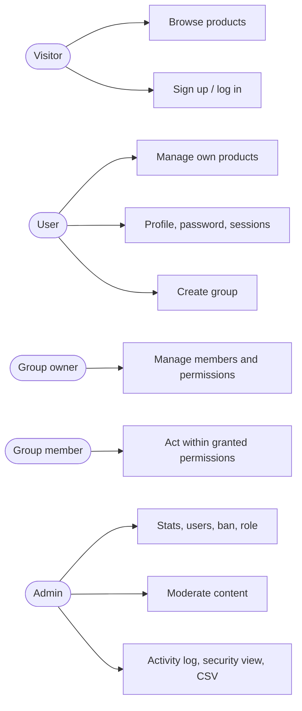
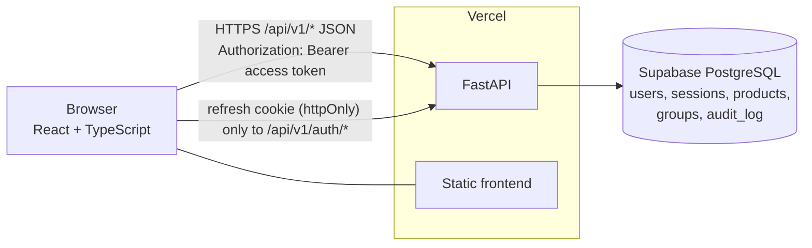
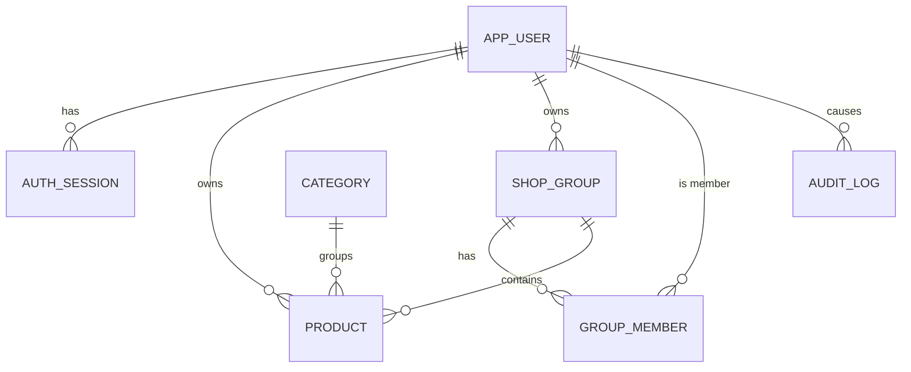
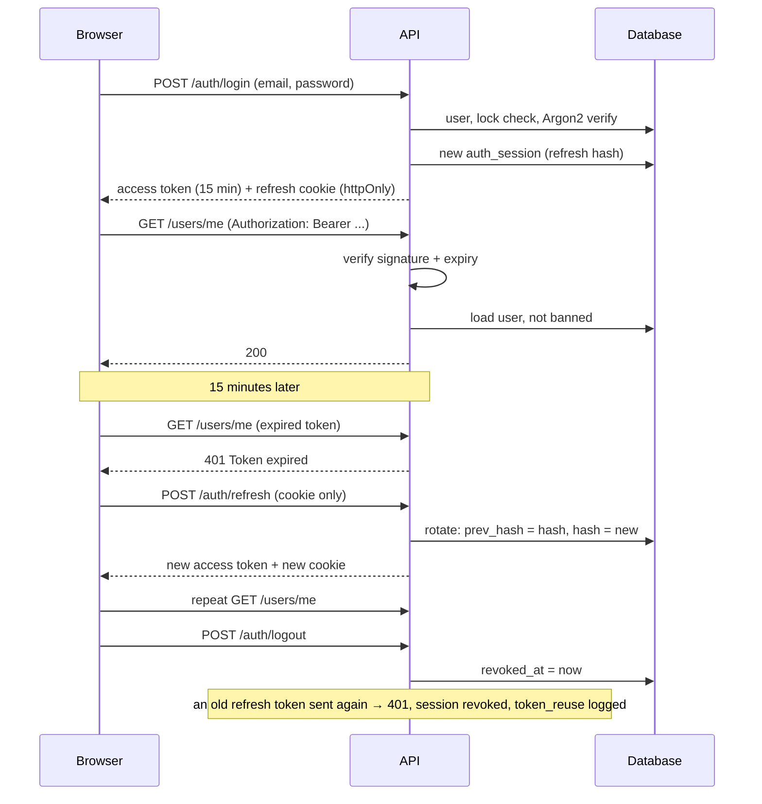
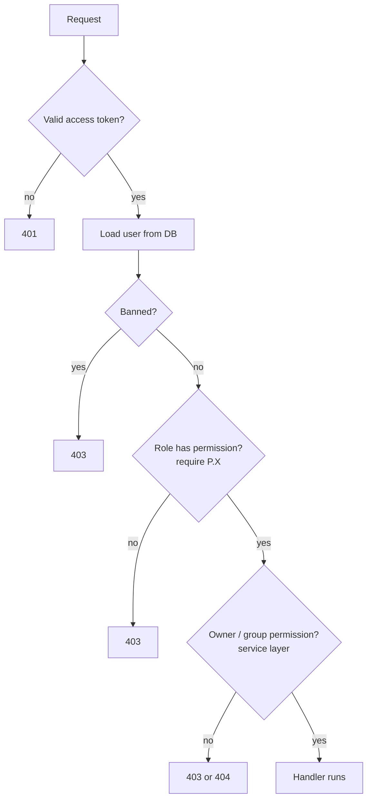

Independent University, Bangladesh
CSE309 Web Application & Internet

# Final Project Submission Report

**Submitted by:**
Name: Most. Tanaka Anta Alam
Student ID: 2310364
Section: 06
Team Number: None

Project Title: Supply Mart
Vercel URL: [https://2310364-s6-supply-mart.vercel.app](https://2310364-s6-supply-mart.vercel.app)
GitHub Repository: [https://github.com/hridi61/2310364-s6-supply-mart](https://github.com/hridi61/2310364-s6-supply-mart)

**Submitted To:** Sayef Reyadh, Adjunct Lecturer, Department of CSE, Independent University, Bangladesh
Semester: Autumn 2026 · Date of Submission: 28 November 2026

> **নোট:** টেস্ট অ্যাকাউন্টের user ID ও password এই ফাইলে নেই। সেগুলো শুধু PDF রিপোর্টের Appendix-এ আছে।

## 1. Executive Summary

### 1.1 Project overview

Supply Mart is a small online grocery marketplace for Bangladesh. People sign up, list everyday items (rice, lentils, oil, vegetables, fish, eggs, spices) as their own products, and form shop teams (groups) in which members hold different permissions. Anyone can browse the public catalogue. An admin moderates users and content through a dashboard. Stack: React + TypeScript (Vite), FastAPI, SQLModel, Supabase PostgreSQL, deployed on Vercel.

### 1.2 What was built since the mid assessment

- **JWT authentication** with Argon2 + pepper, 15-minute access token, rotating httpOnly refresh cookie, logout, session list and revoke, lockout
- **Role based access control**: roles `user` and `admin`, one RBAC module, ownership rules, group permissions (create, update, stock), admin self-protection
- **Admin dashboard**: statistics, users (search, filters, pagination, detail, ban, role, bulk), content moderation, activity (audit) log, security view, CSV exports
- **Audit logging**, brute-force protection, automated tests (21), deployment on Vercel with Supabase

### 1.3 Live links

| Item | Link |
|---|---|
| GitHub repository | https://github.com/hridi61/2310364-s6-supply-mart |
| Vercel frontend | https://2310364-s6-supply-mart.vercel.app |
| API | https://2310364-s6-supply-mart.vercel.app/api/v1 |
| API docs | https://2310364-s6-supply-mart.vercel.app/api/docs |
| Video demo | TBD |

*Table 1: links*

---

# Part A. Product Requirements (PRD)

### A1. Problem Statement

Small shopkeepers and home sellers in Bangladesh have no simple shared place to list what they sell, and customers cannot compare items from several sellers in one place. A shared platform also needs control: sellers must not edit each other's items, a shop run by several people needs different rights for different people (the owner decides, a helper may only update stock), and the platform owner must be able to remove abusive users and see who did what.

### A2. Users and Roles

| Role | Who | Main tasks | Must never be able to |
|---|---|---|---|
| Visitor | Not logged in | Browse, search and sort products; sign up; log in | Create or change anything; open admin pages |
| User | Logged-in seller/buyer | Manage own products; edit profile and password; manage own sessions; create groups | Change another user's product; see another user's sessions; use admin endpoints |
| Group member | A user inside a group | Do only what the owner granted: `create`, `update` or `stock` | Delete the group, rename it, manage members, delete other people's products |
| Group owner | The user who created the group | Everything in the group, including members and permissions | Act outside own group |
| Admin | Platform moderator | View stats, users, content, activity; ban/unban; change roles of others; delete content; export CSV | Change own role; ban an admin (including self) |

*Table 2: users and roles*

### A3. Goals and Success Measures

| ID | Goal | Measure |
|---|---|---|
| G1 | No user can change another user's data | Automated test: other user gets 403 on PATCH/DELETE of a product (`test_product_writes_need_login_and_ownership`) |
| G2 | Sessions are short-lived and revocable | Access token ≤ 15 min; logout makes the refresh token fail with 401 (`test_logout_really_invalidates_session`) |
| G3 | A banned user is stopped immediately | Next request with the old token returns 403 (`test_banned_user_is_rejected_on_next_request`) |
| G4 | Brute-force login is slowed | 5 wrong passwords lock the account for 15 min, then 429 even for the right password (`test_lockout_after_five_failures`) |
| G5 | Admin can moderate and audit | Every ban, role change, delete, login failure and export appears in the activity log with IP and browser |
| G6 | The app works live | Every feature in Part D works on the Vercel URL; data persists in Supabase |

*Table 3: goals and measures*

### A4. Scope and Non-Goals

**In scope:** signup/login/logout, JWT access and refresh, profile and password change, session management, roles and RBAC, product ownership, groups with member permissions, admin dashboard, audit log, CSV export, deployment.

**Out of scope (and why):** online payment and delivery (not needed to show security); orders and cart (replaced by product ownership as the "records"); email verification and password reset (needs an email service); social login (the course asks for our own JWT login); image upload (products use an emoji icon).

**Assumptions and constraints:** latest Chrome, Edge and Firefox; Vercel serverless (no permanent local disk, so Supabase PostgreSQL is used); free-tier Supabase can pause when idle; the first admins come from a seed script, never from public sign-up.

### A5. User Stories

| ID | Story |
|---|---|
| US-01 | As a visitor, I want to sign up with email and a strong password so that I get my own account. |
| US-02 | As a user, I want to log in and stay logged in safely so that I do not retype my password every 15 minutes. |
| US-03 | As a user, I want to log out and see my active sessions so that I can end a session on a lost device. |
| US-04 | As a user, I want to change my name, phone and password so that my account stays correct and safe. |
| US-05 | As a user, I want to add, edit and delete only my own products so that nobody else can change them. |
| US-06 | As a group owner, I want to give each member only the permissions they need so that a helper can update stock but not delete products. |
| US-07 | As a group member, I want to see what I am allowed to do so that I am not surprised by a denied action. |
| US-08 | As a group owner, I want to be the only one who can rename or delete the group and manage members. |
| US-09 | As an admin, I want to search and filter users and ban one with a reason so that abusive accounts stop at once. |
| US-10 | As an admin, I want to see who logged in, failed to log in, changed roles or deleted things so that I can investigate problems. |
| US-11 | As an admin, I want to delete inappropriate products and groups, one or many, so that the catalogue stays clean. |
| US-12 | As an admin, I want to export users, products and activity as CSV so that I can report outside the app. |
| US-13 | As the system owner, I want admins to be unable to change their own role or ban another admin so that one account cannot take over. |

*Table 4: user stories*

---

# Part B. Software Requirements (SRS)

### B1. Introduction

**Purpose:** exact, testable requirements of Supply Mart. **Readers:** instructor, developers. 

| Term | Meaning |
|---|---|
| JWT | JSON Web Token: a signed token proving who the caller is |
| Access token | Short-lived JWT (15 min) sent in the `Authorization: Bearer` header |
| Refresh token | Long-lived (7 days) random value in an httpOnly cookie, stored only as a SHA-256 hash on the server |
| RBAC | Role-Based Access Control: what a caller can do depends on the role |
| Role | `user` or `admin`, stored in the database |
| Permission | A named right, for example `admin:users:ban` (global) or `update` (inside a group) |
| Audit log | Table of security-relevant events with user, IP, browser and time |

References: RFC 7519 (JWT), OWASP ASVS, FastAPI and SQLModel documentation.

### B2. Functional Requirements

**Authentication (FR-AUTH)**

| ID | Requirement |
|---|---|
| FR-AUTH-01 | The system shall let a visitor sign up with email, name and password; email is unique case-insensitively (409 on duplicate); the role is always `user`. |
| FR-AUTH-02 | The system shall validate the password (8–128 characters, at least one letter and one digit) and store it only as an Argon2 hash made from the password combined with a server-side pepper from an environment variable. |
| FR-AUTH-03 | The system shall answer a wrong password and an unknown email with the same 401 message. |
| FR-AUTH-04 | The system shall issue a signed JWT (HS256) access token with claims `sub`, `role`, `iat`, `exp`, `jti` that expires in 15 minutes or less. |
| FR-AUTH-05 | On every protected request the system shall verify signature and expiry, load the user from the database and reject a banned user; missing, invalid, tampered or expired tokens return 401, a banned user 403. |
| FR-AUTH-06 | The system shall set a refresh token in an httpOnly, SameSite=Strict cookie limited to `/api/v1/auth`, and replace it on every refresh (rotation). |
| FR-AUTH-07 | The system shall treat reuse of an already-rotated refresh token as theft, revoke that session and log `token_reuse` (a 10-second grace window covers two browser tabs refreshing at once). |
| FR-AUTH-08 | The system shall revoke the session on logout so the refresh token no longer works. |
| FR-AUTH-09 | The system shall let a user list and revoke own sessions only (another user's session returns 404). |
| FR-AUTH-10 | After 5 failed logins in a row the system shall lock the account for 15 minutes and return 429; a successful login resets the counter. |
| FR-AUTH-11 | The system shall let a user change own name and phone (Bangladesh mobile format); email and role cannot be changed here. |
| FR-AUTH-12 | The system shall require the current password to change the password, validate the new one, record failed attempts in the audit log and revoke all other sessions on success. |
| FR-AUTH-13 | The frontend shall refresh the token once on a 401, log the user out if that fails or the user is banned, and show no guest content while the session is being restored. |

**RBAC and groups (FR-RBAC)**

| ID | Requirement |
|---|---|
| FR-RBAC-01 | The system shall store each user's role (`user` or `admin`) in the database and read it from there on every request, so a role change applies at once. |
| FR-RBAC-02 | The system shall check permissions through one module (`app/rbac.py` with `app/rbac_constants.py`) used by every protected endpoint. |
| FR-RBAC-03 | The system shall enforce every rule on the server; hiding a button in the UI is never the only protection. |
| FR-RBAC-04 | The system shall let only the product owner (or an authorised group member) change a product, and only the owner or the group owner delete it; others get 403. Platform products (no owner) cannot be changed by users. |
| FR-RBAC-05 | The system shall support group permissions `create` (add products to the group), `update` (edit group products) and `stock` (change only `stock` and `is_active`). |
| FR-RBAC-06 | The system shall let only the group owner rename or delete the group and add, change or remove members. |
| FR-RBAC-07 | The system shall answer a non-member with 404 for a group, so group existence is not revealed. |
| FR-RBAC-08 | The system shall not let an admin change their own role. |
| FR-RBAC-09 | The system shall not let anyone ban an admin, including themselves. |
| FR-RBAC-10 | The system shall reject a banned user's very next request (403) and revoke all their sessions. |
| FR-RBAC-11 | The frontend shall show route guards and menus that match the server rules (visitor, user, admin). |

**Admin dashboard (FR-ADM)**

| ID | Requirement |
|---|---|
| FR-ADM-01 | The system shall show statistics: users, admins, banned users, products, groups, new in the last 7 days, active sessions, failed logins in 24 hours. |
| FR-ADM-02 | The system shall list users with search (name/email), filters (role, status) and pagination. |
| FR-ADM-03 | The system shall show a user's detail: products, groups, sessions and recent activity. |
| FR-ADM-04 | The system shall ban a user with a required reason, and unban. |
| FR-ADM-05 | The system shall change a user's role (not the admin's own). |
| FR-ADM-06 | The system shall revoke all sessions of a user. |
| FR-ADM-07 | The system shall ban or unban many users at once and report how many were done and skipped (admins are skipped). |
| FR-ADM-08 | The system shall list all products and groups with filters and delete one or many. |
| FR-ADM-09 | The system shall list the activity log with filters (event, user, search in email/IP/detail) and pagination. |
| FR-ADM-10 | The system shall show failed logins by IP and by account and currently locked accounts. |
| FR-ADM-11 | The system shall export users, products and activity as CSV using the current filters, and neutralise spreadsheet formulas (`=`, `+`, `-`, `@`). |
| FR-ADM-12 | The system shall log: signup, login, login_failed, logout, password_change(_failed), role_change, ban, unban, delete, export, session_revoke, token_reuse. |

**Domain: products (FR-DOM)**

| ID | Requirement |
|---|---|
| FR-DOM-01 | The system shall list products publicly with category filter, name search, price sort, group filter and pagination (`X-Total-Count` header). |
| FR-DOM-02 | The system shall show one product publicly; for a logged-in caller it also says `can_edit`, `can_delete`, `can_stock`. |
| FR-DOM-03 | The system shall create a product owned by the caller, optionally inside a group where the caller has `create`. |
| FR-DOM-04 | The system shall update (partial) and delete a product following FR-RBAC-04/05. |
| FR-DOM-05 | The system shall list "my products" (owned by the caller only). |

*Tables 5–8: functional requirements*

### B3. Non-Functional Requirements

| ID | Category | Requirement |
|---|---|---|
| NFR-01 | Security | `JWT_SECRET` (≥ 32 chars), `PEPPER` and database credentials live only in environment variables; the app refuses to start on Vercel without them. |
| NFR-02 | Security | Responses never contain `password_hash` or token hashes; errors never show stack traces (generic 500). |
| NFR-03 | Security | CORS allows only the configured frontend origins; security headers `X-Content-Type-Options`, `X-Frame-Options`, `Referrer-Policy` are set. |
| NFR-04 | Security | All database access uses the ORM with bound parameters (no string-built SQL). |
| NFR-05 | Performance | List endpoints are paginated (limit ≤ 100); detail requests answer in under 500 ms excluding a serverless cold start. |
| NFR-06 | Usability | The UI is responsive from 360 px and has loading, error and empty states. |
| NFR-07 | Reliability | Data lives in Supabase PostgreSQL and survives restarts and redeploys. |
| NFR-08 | Maintainability | One RBAC module; code split into router, service, model, schema per feature; 21 automated tests. |

*Table 9: non-functional requirements*

### B4. Roles and Permission Matrix

| Endpoint group | Visitor | User | Group member | Group owner | Admin |
|---|:---:|:---:|:---:|:---:|:---:|
| Browse / search products, categories | yes | yes | yes | yes | yes |
| Sign up, log in | yes | — | — | — | — |
| Own profile, password, sessions | no (401) | own | own | own | own |
| Create product (no group) | no (401) | yes | yes | yes | yes |
| Edit / delete own product | no (401) | own | own | own | own |
| Edit another user's product | no (401) | no (403) | only with `update` (or `stock` for stock fields) | yes (own group) | no (403) |
| Delete another user's product | no (401) | no (403) | no (403) | yes (own group) | via admin moderation |
| Add product to a group | no (401) | no (403) | only with `create` | yes | no (403) |
| Rename / delete group, manage members | no (401) | no (403) | no (403) | yes | via admin moderation (delete) |
| Admin endpoints (`/api/v1/admin/*`) | no (401) | no (403) | no (403) | no (403) | yes |

*Table 10: endpoint groups by roles*

| Group permission | Allows | Only the owner can |
|---|---|---|
| `create` | add new products to the group | rename the group |
| `update` | edit any field of group products | delete the group |
| `stock` | change only `stock` and `is_active` | add, change or remove members; delete other people's products |

*Table 11: group permissions (the group owner always has all three)*

| Admin rule | Behaviour |
|---|---|
| Change own role | refused, 403 |
| Ban an admin or self | refused, 403 (bulk ban skips admins and reports them) |
| Extra rights inside a group | none; admins moderate content only through the admin pages |

*Table 12: admin rules*

### B5. Use Cases

| UC | Actor | Main flow | Alternative / error flows | Postcondition |
|---|---|---|---|---|
| UC-1 Log in and refresh | User | 1. Enter email and password. 2. API checks lock and password. 3. API returns access token and sets refresh cookie. 4. After 15 min a request returns 401. 5. Frontend calls refresh and repeats the request. | Wrong password: 401. 5 failures: 429. Banned: 403 with reason. Refresh fails: logout. | New session row; `login` logged. |
| UC-2 Create a record | User | 1. Open "new product". 2. Fill form. 3. API checks `product:write`, validates, saves with `owner_id`. | Not logged in: 401. Invalid input: 422. Group without `create`: 403. | Product owned by caller. |
| UC-3 Change a member's permissions | Group owner | 1. Open group. 2. Tick/untick permissions for a member. 3. API checks caller is owner and saves. | Non-owner: 403. Non-member: 404. Unknown permission: 422. | Member's rights changed at once. |
| UC-4 A denied action | Group member with `stock` | 1. Open a group product. 2. Try to change its price. | API returns 403; UI only offers the stock box. | Product unchanged. |
| UC-5 Ban a user | Admin | 1. Open user detail. 2. Enter reason, click ban. 3. API refuses admins, sets ban, revokes sessions, logs `ban`. | Target is admin: 403. Reason too short: 422. | Next request of the banned user returns 403. |
| UC-6 Read the audit log | Admin | 1. Open activity log. 2. Filter by event or search an email/IP. 3. Export CSV (logged as `export`). | Not admin: 403. | Events visible with IP, browser, time. |


*Figure 1: use case diagram · Table 13: use case descriptions*

### B6. Acceptance Criteria

| ID | Given / When / Then | Test |
|---|---|---|
| AC-01 | Given an expired access token, when a protected endpoint is called, then 401 "Token expired". | `test_token_rejections` |
| AC-02 | Given a token with a changed payload or wrong secret, when used, then 401. | `test_token_rejections` |
| AC-03 | Given user A owns product 5, when user B sends PATCH or DELETE, then 403 and the product is unchanged. | `test_product_writes_need_login_and_ownership` |
| AC-04 | Given a member with only `stock`, when they change `price`, then 403; when they change `stock`, then 200. | `test_group_permissions` |
| AC-05 | Given a banned user with a valid token, when they call any endpoint, then 403 on the very next request. | `test_banned_user_is_rejected_on_next_request` |
| AC-06 | Given an admin, when they ban another admin or change their own role, then 403. | `test_admin_safety_rules` |
| AC-07 | Given 5 failed logins, when the right password is sent, then 429. | `test_lockout_after_five_failures` |
| AC-08 | Given a used refresh token, when it is sent again, then 401 and the session is revoked. | `test_refresh_rotation_reuse_and_logout` |
| AC-09 | Given a logged-out session, when its refresh cookie is sent, then 401. | `test_logout_really_invalidates_session` |
| AC-10 | Given a non-admin, when calling `/api/v1/admin/stats`, then 403; given an admin, 200. | `test_admin_endpoints_need_admin_role` |

*Table 14: acceptance criteria*

### B7. Traceability Matrix

| Requirement | Endpoint / screen | Test | Screenshot |
|---|---|---|---|
| FR-AUTH-01, 02, 03 | `POST /auth/signup`, `/auth/login`; Signup/Login pages | `test_signup_login_and_profile`, `test_wrong_password_and_unknown_email_look_the_same` | S1 |
| FR-AUTH-04, 05 | `get_current_user`; every protected endpoint | `test_token_rejections` | S7 |
| FR-AUTH-06, 07, 08 | `POST /auth/refresh`, `/auth/logout` | `test_refresh_rotation_reuse_and_logout`, `test_logout_really_invalidates_session` | S8 |
| FR-AUTH-09 | `GET/DELETE /auth/sessions`; Profile page | `test_sessions_list_and_revoke` | S4 |
| FR-AUTH-10 | `POST /auth/login` | `test_lockout_after_five_failures` | S16 |
| FR-AUTH-11, 12 | `PATCH /users/me`, `POST /users/me/password`; Profile page | `test_change_password`, `test_signup_login_and_profile` | S3 |
| FR-AUTH-13 | `services/http.ts`, `AuthContext` | manual (S7, S8) | S7, S8 |
| FR-RBAC-01, 02, 03 | `rbac.py`, all routers | `test_admin_endpoints_need_admin_role` | S6 |
| FR-RBAC-04 | `PATCH/DELETE /products/{id}` | `test_product_writes_need_login_and_ownership`, `test_seeded_platform_products_cannot_be_edited_by_users` | S6 |
| FR-RBAC-05, 06, 07 | `/groups/*`, product endpoints; Group page | `test_group_permissions` | S5 |
| FR-RBAC-08, 09 | `/admin/users/{id}/role`, `/ban` | `test_admin_safety_rules`, `test_bulk_ban_skips_admins` | S13 |
| FR-RBAC-10 | `get_current_user`, ban | `test_banned_user_is_rejected_on_next_request` | S9 |
| FR-ADM-01 | `GET /admin/stats` | `test_activity_log_security_and_csv_export` | S10 |
| FR-ADM-02, 03, 06 | `GET /admin/users`, `/users/{id}`, `/revoke-sessions` | `test_admin_users_filters_detail_and_moderation` | S11, S12 |
| FR-ADM-04, 05, 07 | ban, unban, role, bulk | `test_admin_safety_rules`, `test_bulk_ban_skips_admins` | S13 |
| FR-ADM-08 | `/admin/products`, `/admin/groups`, bulk-delete | `test_admin_users_filters_detail_and_moderation` | S14 |
| FR-ADM-09, 10, 12 | `/admin/activity`, `/admin/security` | `test_activity_log_security_and_csv_export` | S15, S16 |
| FR-ADM-11 | `/admin/export/*` | `test_activity_log_security_and_csv_export`, `test_csv_formula_injection_is_neutralised` | S17 |
| FR-DOM-01..05 | `/products`, `/products/mine`; product pages | `test_health_seed_and_public_reads`, `test_filter_and_sort`, `test_crud_flow_and_validation` | S2 |

*Table 15: traceability*

---

# Part C. Technical Design (TDD)

### C1. Technology Stack

| Component | Technology | Version | Reason |
|---|---|---|---|
| Frontend | React + TypeScript + Vite | React 19.3.0, TypeScript 7.0.2, Vite 8.3.2 | Course requirement, typed API data |
| Routing | React Router (HashRouter) | react-router-dom 7.18.5 | Deep links and reloads work on Vercel without extra rewrites |
| Backend | FastAPI (Python 3.13.17) | FastAPI 0.162.0 | Validation, OpenAPI docs, dependency injection for RBAC |
| ORM | SQLModel | 0.0.48 | One class as table and schema |
| Database | Supabase PostgreSQL (SQLite locally), psycopg driver | psycopg 3.3.6 | Persistent hosted data |
| Password hashing | `pwdlib[argon2]` | pwdlib 0.4.2 (argon2-cffi 25.1.0) | Argon2 is a memory-hard hash |
| JWT | PyJWT | 2.15.1 | Sign and verify access tokens |
| Tests | pytest + FastAPI TestClient | pytest 9.2.0 | 21 API tests |
| Hosting | Vercel | — | Frontend and API in one project |

*Table 16: technology stack. Versions were read from `pip` and `npm ls`; development used Python 3.13.17 and Node.js 24.21.0, uvicorn 0.54.0 runs the API locally.*

### C2. System Architecture


*Figure 2: system architecture.* The browser loads the static frontend from Vercel. All data calls go to `/api/v1/*` on the same origin; the access token travels in the `Authorization` header and the refresh token only in an httpOnly cookie that is sent to `/api/v1/auth/*`. The API reads and writes PostgreSQL and records every security event in `audit_log`.

### C3. Backend and Frontend Structure

```
backend/
  main.py                  app, CORS, security headers, routers, error handler
  app/
    config.py              settings from environment variables
    database.py            engine, session, init_db (tables + column check + seed)
    security.py            Argon2 + pepper, JWT, refresh token helpers
    rbac_constants.py      permission names and role → permissions
    rbac.py                require(permission), group_permissions()
    auth/                  models (User, AuthSession), service, router, dependencies
    catalog/               products and categories (ownership rules in service.py)
    groups/                groups, members, group permissions
    admin/                 stats, users, moderation, activity, security, CSV
    audit/                 AuditLog model and record()
    migrate.py             adds new columns to the old product table
    seed.py, seed_demo.py  categories/products; demo accounts for the instructor
  tests/                   test_auth.py, test_rbac.py, test_products.py
frontend/src/
  services/                http.ts (token, refresh, errors), api.ts, auth.ts, groups.ts, admin.ts
  auth/                    AuthContext.tsx, guards.tsx (RequireAuth, RequireAdmin)
  components/              Layout (role-based menu), ProductForm, PermChecks, Pagination, Alert
  pages/                   product, login, signup, profile, groups pages; pages/admin/*
  types/, utils/
```
Routers parse the request and call a service; dependencies do the reusable checks (token, role); services hold the business rules (ownership, group permissions, ban rules) and know nothing about HTTP.

### C4. Data Model


*Figure 3: ER diagram*

| Table | Columns (key points) |
|---|---|
| `app_user` | id, email (unique, lowercase), name, phone, password_hash (Argon2), role (`user`/`admin`), is_banned, ban_reason, banned_at, failed_login_count, locked_until, last_login_at, created_at, updated_at |
| `auth_session` | id, user_id → app_user, token_hash (SHA-256, unique), prev_token_hash (to detect reuse), ip, user_agent, created_at, last_used_at, expires_at, revoked_at |
| `product` | id, category_id, name_bn, unit, price, stock, icon, is_active, **owner_id** → app_user (null = platform), **group_id** → shop_group, created_at, updated_at |
| `shop_group` | id, name, description, owner_id → app_user, created_at |
| `group_member` | id, group_id, user_id, permissions (`create,update,stock` subset); unique (group_id, user_id) |
| `audit_log` | id, user_id, email, action, detail, ip, user_agent, created_at (indexed by action, ip, email, time) |
| `category` | id, slug (unique), name_bn, icon |

*Tables 17–23.* Roles are a column on `app_user`. A ban is `is_banned` with a reason. A login is an `auth_session` row; revoking sets `revoked_at`. Group rights are a comma list on `group_member`; the owner's rights are implied by `shop_group.owner_id`. Because `create_all` does not alter old tables, `migrate.py` adds `owner_id` and `group_id` to the existing `product` table at start-up.

### C5. API Design

Base path `/api/v1`. Errors use FastAPI's format `{"detail": "..."}`; validation errors (422) list the failing fields.

| Method + path | Auth | Role / permission | Success | Errors |
|---|---|---|---|---|
| `POST /auth/signup` | public | — | 201 | 409, 422 |
| `POST /auth/login` | public | — | 200 + cookie | 401, 403 (banned), 429 |
| `POST /auth/refresh` | cookie | — | 200 + new cookie | 401 |
| `POST /auth/logout` | cookie | — | 204 | — |
| `GET /auth/sessions`, `DELETE /auth/sessions/{id}` | token | `session:manage` | 200 / 204 | 401, 404 |
| `GET/PATCH /users/me`, `POST /users/me/password` | token | `profile:manage` | 200 / 204 | 400, 401, 422 |
| `GET /categories`, `GET /products`, `GET /products/{id}` | public | — | 200 | 404, 422 |
| `GET /products/mine` | token | `product:write` | 200 | 401 |
| `POST /products` | token | `product:write` (+ group `create`) | 201 | 401, 403, 422 |
| `PATCH /products/{id}` | token | owner / group `update` or `stock` | 200 | 401, 403, 404, 422 |
| `DELETE /products/{id}` | token | owner / group owner | 204 | 401, 403, 404 |
| `POST/GET /groups`, `GET /groups/{id}` | token | `group:create`; member for detail | 201 / 200 | 401, 404 |
| `PATCH/DELETE /groups/{id}` | token | group owner | 200 / 204 | 403, 404 |
| `POST/PATCH/DELETE /groups/{id}/members[/{uid}]` | token | group owner | 201 / 200 / 204 | 403, 404, 409, 422 |
| `GET /admin/stats` | token | `admin:stats` | 200 | 401, 403 |
| `GET /admin/users`, `GET /admin/users/{id}` | token | `admin:users:read` | 200 | 403, 404 |
| `POST /admin/users/{id}/ban`, `/unban`, `/revoke-sessions`, `POST /admin/users/bulk` | token | `admin:users:ban` | 200 | 403, 404, 422 |
| `PATCH /admin/users/{id}/role` | token | `admin:users:role` | 200 | 403, 404 |
| `GET /admin/products`, `GET /admin/groups`, `DELETE`, `POST …/bulk-delete` | token | `admin:content` | 200 / 204 | 403, 404 |
| `GET /admin/activity`, `GET /admin/security` | token | `admin:activity` | 200 | 403 |
| `GET /admin/export/{users,products,activity}` | token | `admin:export` | 200 CSV | 403 |
| `GET /api/health`, `/api/docs` | public | — | 200 | — |

*Table: endpoint list*

### C6. JWT Authentication Design


*Figure 4: JWT flow*

| Claim | Meaning |
|---|---|
| `sub` | user id |
| `role` | role at issue time (the server still reads the role from the database) |
| `iat`, `exp` | issued at, expiry (+15 min) |
| `jti` | unique token id |

*Table: token claims.* HS256 with `JWT_SECRET` (≥ 32 bytes, environment variable); the decoder pins the algorithm list so a token cannot pick its own algorithm. **Lifetimes:** access 15 minutes (a stolen token is useful only briefly), refresh 7 days (user does not log in daily). **Storage:** the access token lives only in JavaScript memory (not localStorage), which makes theft through XSS harder; the refresh token is an httpOnly cookie, SameSite=Strict, `Path=/api/v1/auth`, `Secure` on Vercel, so scripts cannot read it and other sites cannot send it (CSRF). **Every request:** signature, expiry, user exists, user not banned. **Frontend on 401:** one silent refresh (shared by parallel requests), repeat the request, otherwise log out.

### C7. RBAC Design


*Figure 5: authorisation flow.* Permissions are constants in `rbac_constants.py`; `ROLE_PERMISSIONS` maps `user` and `admin` to sets. The reusable check:

```python
def require(permission: str):
    def checker(user: Annotated[User, Depends(get_current_user)]) -> User:
        if permission not in ROLE_PERMISSIONS.get(user.role, set()):
            raise HTTPException(403, "Not enough permissions")
        return user
    return Depends(checker)
```
Used as `user: Annotated[User, require(P.ADMIN_USERS_BAN)]`. **Ownership** is checked in `catalog/service.py` (`can_update`, `can_delete`) and group rights in `rbac.group_permissions()`; a non-member gets 404 for a group. **New permission:** add a constant to `P`, put it in the role sets and use `require(P.NEW)` on the endpoint. **Special rules:** `change_role` refuses the caller's own id; `ban_user` refuses any admin; `get_current_user` returns 403 for a banned user on every request.

### C8. Admin Dashboard Design

| Page | Endpoints | Filters / pagination | Actions | Audit events |
|---|---|---|---|---|
| Overview | `GET /admin/stats` | — | — | — |
| Users | `GET /admin/users`, `POST /admin/users/bulk`, export | search, role, status, page 10 | bulk ban/unban, CSV | `ban`, `unban`, `export` |
| User detail | `GET /admin/users/{id}`, ban, unban, role, revoke-sessions | — | ban with reason, role, revoke | `ban`, `unban`, `role_change`, `session_revoke` |
| Content | `GET /admin/products`, `/admin/groups`, bulk-delete, export | search, page 10 | delete one or many, CSV | `delete`, `export` |
| Activity log | `GET /admin/activity`, export | event, search (email/IP/detail), page 15 | CSV | `export` |
| Security | `GET /admin/security` | 1, 7 or 30 days | — | — |

*Table: admin pages.* Bulk ban/unban returns `{done: [...], skipped: [{id, reason}]}` and the page shows both counts. CSV export uses the same query builder as the list, so filters apply, caps at 5 000 rows, and prefixes cells starting with `=`, `+`, `-`, `@` with `'`.

### C9. Security Design and Threats

| Threat | Defence | Where |
|---|---|---|
| Password database leak | Argon2 hash with a pepper kept outside the database | `security.py` |
| Stolen access token | 15-minute lifetime, kept in memory, ban applies on next request | `security.py`, `auth/dependencies.py` |
| Stolen refresh token | Rotation, reuse detection, httpOnly cookie, hash-only storage, revoke on logout/password change | `auth/service.py` |
| Brute-force login | Lock 15 min after 5 failures, audit of each failure, security view | `auth/service.py` |
| Privilege escalation | Role read from database, one `require()` module, admin self-protection | `rbac.py`, `admin/service.py` |
| Access to another user's record | Ownership checks in services, 403/404, group non-members get 404 | `catalog/service.py`, `groups/service.py` |
| XSS | React escapes output; no raw HTML; token not in localStorage | `frontend/src` |
| CSRF | Refresh cookie SameSite=Strict and path-limited; API uses a Bearer header | `auth/router.py` |
| CORS misuse | Explicit origin list, no `*` | `main.py` |
| Secrets in the repository | Only `.env.example`; app stops on Vercel without secrets | `config.py` |
| SQL injection | ORM with bound parameters only | all services |
| Over-posting of fields | Separate input schemas (no `role`, `owner_id`, `is_banned` in them); role only through the admin endpoint | `schemas.py` |
| Account enumeration | Same 401 message and constant-time dummy hash | `auth/service.py` |
| CSV formula injection | Cells prefixed with `'` | `admin/service.py` |

*Table: threats and defences*

### C10. Deployment on Vercel

The repository is connected to one Vercel project; `vercel.json` defines two services: `backend` (root `backend`, FastAPI, entrypoint `main:app`) and `frontend` (root `frontend`, Vite), with rewrites `/api/*` → backend and everything else → frontend. The frontend calls the API with relative URLs (same origin), so no localhost address is used and CORS is not needed in production (it is still limited to the listed origin). A push to `main` redeploys; to redeploy by hand use Deployments → Redeploy.

| Variable | Purpose |
|---|---|
| `DATABASE_URL` | Supabase transaction pooler URL |
| `JWT_SECRET` | signs access tokens (≥ 32 chars) |
| `PEPPER` | secret mixed into password hashes |
| `CORS_ORIGINS` | allowed frontend origin(s) |
| `ACCESS_TOKEN_MINUTES`, `REFRESH_TOKEN_DAYS`, `REUSE_GRACE_SECONDS`, `COOKIE_SECURE` | optional tuning |

*Table: environment variable names (values are not in the repository).* Demo accounts are created once from a developer machine with `python -m app.seed_demo` (reads `DEMO_PASSWORD` from the environment).

### C11. Testing

Automated API tests run with `cd backend && pytest -q` against a temporary SQLite database (21 tests). Manual tests were done on the live site (Part D).

| Test | Requirement | Result |
|---|---|---|
| `test_signup_login_and_profile` | FR-AUTH-01, 02, 11 | pass |
| `test_wrong_password_and_unknown_email_look_the_same` | FR-AUTH-03 | pass |
| `test_token_rejections` (missing, junk, forged, expired, tampered) | FR-AUTH-04, 05 | pass |
| `test_refresh_rotation_reuse_and_logout` | FR-AUTH-06, 07 | pass |
| `test_logout_really_invalidates_session` | FR-AUTH-08 | pass |
| `test_sessions_list_and_revoke` | FR-AUTH-09 | pass |
| `test_lockout_after_five_failures` | FR-AUTH-10 | pass |
| `test_change_password` | FR-AUTH-12 | pass |
| `test_admin_endpoints_need_admin_role` | FR-RBAC-01..03 | pass |
| `test_product_writes_need_login_and_ownership` | FR-RBAC-04 | pass |
| `test_seeded_platform_products_cannot_be_edited_by_users` | FR-RBAC-04 | pass |
| `test_group_permissions` | FR-RBAC-05, 06, 07 | pass |
| `test_admin_safety_rules` | FR-RBAC-08, 09 | pass |
| `test_banned_user_is_rejected_on_next_request` | FR-RBAC-10 | pass |
| `test_bulk_ban_skips_admins` | FR-ADM-07 | pass |
| `test_admin_users_filters_detail_and_moderation` | FR-ADM-02, 03, 06, 08 | pass |
| `test_activity_log_security_and_csv_export` | FR-ADM-09, 10, 11, 12 | pass |
| `test_csv_formula_injection_is_neutralised` | FR-ADM-11 | pass |
| `test_health_seed_and_public_reads` | FR-DOM-01, 02 | pass |
| `test_filter_and_sort` | FR-DOM-01 | pass |
| `test_crud_flow_and_validation` | FR-DOM-03, 04 | pass |

*Table: tests and results (`python -m pytest -q`: 21 passed).*

---

# Part D. Evidence: Screenshots of the Running Application

> Every screenshot must be taken on the **deployed Vercel URL** with the address bar visible. Mask passwords and tokens. This section is only for the PDF; paste the images there.

### D1. User Side
S1 signup/login with a validation error · S2 own products only · S3 profile and change password (wrong current password rejected) · S4 sessions list with revoke · S5 group page with members and permissions · S6 an action denied by RBAC (message in the app and 403 in the Network tab)

### D2. Security Behaviour
S7 Network tab: Authorization header (masked) and an expired token returning 401 · S8 refresh request returning a new token, and the httpOnly cookie in the Application tab · S9 a banned user rejected on the next request

### D3. Admin Dashboard
S10 statistics · S11 users list with search, filters, pagination · S12 user detail with sessions and activity · S13 ban dialog with reason and banned state · S14 content moderation with a bulk action · S15 activity log with filters · S16 security view · S17 a downloaded CSV opened

### D4. Deployment
S18 Vercel frontend project and production deployment · S19 Vercel environment variable **names** (values hidden) · S20 live API docs page

### D5. Tests
S21 output of `pytest -q`

---

# Part E. Project Management and Conclusion

### E1. How to Run and Test

Prerequisites: Python 3.10+, Node.js 22+.

```bash
# backend
cd backend
python -m venv .venv && source .venv/bin/activate     # Windows: .venv\Scripts\Activate.ps1
pip install -r requirements.txt
# locally no variables are needed: SQLite and development keys are used
fastapi dev main.py      # http://localhost:8000/api/docs

# demo accounts (reads the password from the environment)
DEMO_PASSWORD="<choose-one>" python -m app.seed_demo

# tests
pytest -q

# frontend (second terminal)
cd frontend && npm install && npm run dev      # http://localhost:5173
```
Environment variables (set in the shell or on Vercel; the app does not read a `.env` file by itself): see `.env.example` (`DATABASE_URL`, `JWT_SECRET`, `PEPPER`, `CORS_ORIGINS`). Test accounts: two admins and three users; their IDs and passwords are in the PDF report (Appendix).

### E2. GitHub Work

| Issue | Pull request | What it delivered |
|---|---|---|
| [#1](https://github.com/hridi61/2310364-s6-supply-mart/issues/1), [#3](https://github.com/hridi61/2310364-s6-supply-mart/issues/3) (mid project) | [#2](https://github.com/hridi61/2310364-s6-supply-mart/pull/2), [#8](https://github.com/hridi61/2310364-s6-supply-mart/pull/8) | Mid project: product CRUD and forms |
| [#9](https://github.com/hridi61/2310364-s6-supply-mart/issues/9) JWT auth, RBAC, groups and admin API | [#12](https://github.com/hridi61/2310364-s6-supply-mart/pull/12) | Users, sessions, Argon2 + pepper, access/refresh tokens, RBAC module, ownership rules, groups with member permissions, admin API, tests |
| [#10](https://github.com/hridi61/2310364-s6-supply-mart/issues/10) Auth, group and admin UI | [#13](https://github.com/hridi61/2310364-s6-supply-mart/pull/13) | Auth context, route guards, login, signup, profile, home and categories pages, groups and admin pages |
| [#11](https://github.com/hridi61/2310364-s6-supply-mart/issues/11) Final report and test accounts | [#14](https://github.com/hridi61/2310364-s6-supply-mart/pull/14) | Final report, viva notes, README with test accounts |

*Table: issues and pull requests. All commits are from my account hridi61.*

### E3. Limitations

- No email verification or password reset: a user who forgets the password cannot recover the account without an admin.
- Lockout is per account, not per IP; a determined attacker can still lock a victim's account.
- The access token is not revoked before expiry (up to 15 minutes), except that a ban or role change is applied immediately because the server reads the database on every request.
- Orders and payments are not part of the final scope.
- Free-tier Supabase can pause when idle; the first request after a pause is slow.
- The audit log has no retention policy; it grows without limit.
- Unbanning a user who is not banned still writes an `unban` event, so repeated clicks add duplicate lines to the activity log (no permission changes).

### E4. Future Work

1. Email verification and password reset, so users can recover accounts.
2. Per-IP rate limiting at the edge, to protect against distributed guessing.
3. Audit log retention and pagination by date range.
4. Orders and cart for customers, reusing the same RBAC module.
5. Two-factor authentication for admins.

### E5. Sources, Libraries and Tools

| Name | Link / version | Used for |
|---|---|---|
| FastAPI | https://fastapi.tiangolo.com | API, dependency injection, OpenAPI docs |
| SQLModel / SQLAlchemy | https://sqlmodel.tiangolo.com | ORM and tables |
| PyJWT | https://pyjwt.readthedocs.io | JWT sign and verify |
| pwdlib (Argon2) | https://github.com/frankie567/pwdlib | Password hashing |
| React, React Router, Vite, TypeScript | npm | Frontend |
| Supabase PostgreSQL | https://supabase.com | Hosted database |
| Vercel | https://vercel.com | Hosting |
| RFC 7519, OWASP ASVS | — | Design reference |
| **Claude (Anthropic) — AI assistant** | claude.ai | Used Claude to draft parts of the backend (authentication, RBAC, groups, admin API), the React pages, the pytest tests, the demo seed and the structure of this report. I set up my own Supabase database and Vercel environment variables, ran the code locally, deployed it, created the demo accounts, and tested login, token refresh, ban, group permissions, the 403 response and CSV export on the live site. I committed and merged the pull requests from my own account. |
